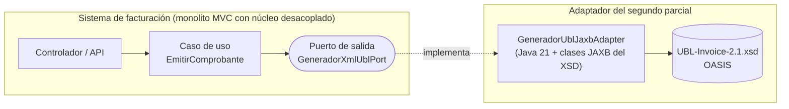

# Segundo parcial — Descripción del caso

**Curso**: Arquitectura de Software · UNAS – FIIS · Grupo A  
**Alumno**: Jorge Steven Tapullima Villar  
**Fecha**: 2026-11-11  
**Requisito**: 1 — Descripción del caso

---

## 1. Problema que se busca resolver

**ABC Software Corp** comercializa abarrotes al por mayor y menor. Su software actual solo registra fichas de almacén (`fecha`, `ingreso`, `salida`, `producto`, `nro_documento`). No emite comprobantes electrónicos: no valida el RUC, no calcula el IGV, el ISC ni el ICBPER, y no genera el documento XML que exige SUNAT.

La **RS N° 097-2012/SUNAT** obliga a emitir la factura y la boleta como documentos electrónicos en XML con la estructura del estándar internacional **UBL 2.1** (Universal Business Language, OASIS). Sin ese XML no hay comprobante: no se puede firmar, enviar al OSE ni obtener la constancia de recepción (CDR).

El primer parcial dejó especificado el sistema (fase Spec-First): casos de uso, modelo de dominio, arquitectura, contrato API y la matriz de trazabilidad SUNAT ↔ UBL. **Este parcial implementa la primera pieza ejecutable: el generador del XML.**

## 2. Contexto técnico del sistema

El generador del XML es una pieza del sistema de facturación de ABC Software Corp. Se ubica donde lo define la arquitectura del primer parcial ([feature 0003](../specs/features/0003-arquitectura-mvc-hexagonal/design.md)): un monolito MVC con núcleo desacoplado por puertos, preparado para evolucionar a hexagonal.

### 2.1 Dónde encaja el generador

El generador **implementa el puerto de salida `GeneradorXmlUblPort`**. El núcleo del sistema entrega los datos del comprobante y recibe el XML; no sabe cómo se construye. Por eso el generador es un módulo independiente: no usa base de datos, servidor web ni ninguna librería de infraestructura aparte de `lxml`.



### 2.2 Tecnologías

| Componente | Función |
|---|---|
| **Java 21** | Lenguaje del generador: es el stack del backend definido en el primer parcial (ADR-001) y el que recomendó el docente para usar JAXB. Razones en el [ADR-0006](../specs/adr/0006-generador-ubl-java-jaxb.md). |
| **JAXB (xjc)** | Genera ≈ 1 240 clases Java desde `UBL-Invoice-2.1.xsd` en cada compilación; el XML se arma llenando esos objetos, sin plantillas. |
| **Maven** | Compila, genera las clases desde el XSD, ejecuta las pruebas y exige cobertura mínima (incluye el Maven Wrapper). |
| **Python 3.10+** | Prototipo de referencia (ADR-0005) y herramientas de verificación; sirve de oráculo en la regresión cruzada. |
| **XSD de OASIS UBL 2.1** | Esquema que define qué XML es válido (`docs/referencias/ubl/`). |
| **JUnit 5, AssertJ, ArchUnit, XMLUnit** | Pruebas unitarias de generación, de reglas de arquitectura y de regresión contra los XML de referencia. |
| **Git / GitHub** | Versionado y entrega; la integración continua corre las pruebas en cada `push`. |

El generador **no usa base de datos** en este parcial: recibe datos y devuelve bytes.

### 2.3 Codificación de caracteres

UTF-8 es la codificación más usada y la que exige el XML de SUNAT. En Windows es frecuente WIN1252 (también llamada ANSI o Latin-1 occidental), que representa la "ñ" y las tildes con bytes distintos. Si un archivo en WIN1252 se lee como UTF-8, o si los datos de entrada no coinciden con la codificación de la base de datos de PostgreSQL, aparecen errores o caracteres corruptos ("Costeño" en lugar de "Costeño").

En este parcial **no se usa base de datos**, así que no se cambia la codificación de ninguna. El generador:

- lee la entrada **siempre** como UTF-8, acepta el BOM que agrega el Bloc de notas y, si el archivo está en WIN1252, lo rechaza con un mensaje claro en vez de corromper los datos;
- escribe el XML en UTF-8 con su declaración (`<?xml version="1.0" encoding="UTF-8"?>`).

## 3. Necesidad de generar documentos XML

En la facturación electrónica peruana, el comprobante **es** el XML. La representación impresa (PDF) es solo una copia. El XML debe:

1. cumplir la estructura del XSD oficial `UBL-Invoice-2.1.xsd` (orden, nombres y tipos de los elementos);
2. llevar los códigos de los catálogos de SUNAT (tipo de documento, moneda, unidad de medida, tributos, afectación del IGV, sistema del ISC);
3. cuadrar sus importes (valor de venta + tributos = importe total);
4. firmarse y enviarse al OSE o a SUNAT (pasos posteriores).

## 4. Relación con la facturación electrónica peruana

| Concepto visto en clase | Cómo se refleja en el XML UBL 2.1 |
|---|---|
| **1001 Gravada** | `TaxSubtotal` con tributo `1000` IGV (categoría `S`). IGV del **18 %**, o del **10 %** solo cuando se indica el régimen de restaurantes y hoteles visto en clase. |
| **1002 Inafecta** | `TaxSubtotal` con tributo `9998` INA (categoría `O`), sin IGV. |
| **1003 Exonerada** | `TaxSubtotal` con tributo `9997` EXO (categoría `E`), sin IGV. |
| **1004 Gratuita** | `TaxSubtotal` con tributo `9996` GRA (categoría `Z`), valor referencial con `PriceTypeCode = 02`; no suma al importe a pagar. |

Los códigos 1001–1004 vienen del Catálogo 14 de SUNAT, que en UBL 2.0 iba en `sac:AdditionalMonetaryTotal`. **Ese elemento no existe en el XSD de UBL 2.1**, así que no se genera: en UBL 2.1 cada categoría se informa como un `TaxSubtotal` con su propio tributo (Guía XML SUNAT, §23–26). Las tasas del 18 % y del 10 % se tratan como parámetros (`RegimenIgv`), no como una regla universal.

## 5. Objetivo de la implementación

Implementar, en Java (el lenguaje del stack del primer parcial), un generador que convierta los datos de un comprobante en el XML `Invoice` UBL 2.1 que exige SUNAT, válido contra el XSD oficial, y comprobarlo con pruebas unitarias de generación.

## 6. Alcance del desarrollo

| Incluido en el segundo parcial | Fuera de alcance (parciales posteriores) |
|---|---|
| Factura (`01`) y boleta (`03`) de venta interna | Firma digital, envío al OSE y CDR |
| Categorías gravada, inafecta, exonerada y gratuita | Notas de crédito y débito, bajas, resúmenes |
| IGV 18 % / 10 %, ISC (3 sistemas), ICBPER | Persistencia en base de datos |
| Contado y crédito con cuotas | Integración con la API REST y la interfaz de usuario |
| Validación de la entrada y validación XSD | Despliegue y empaquetado |
| Pruebas unitarias de generación | Integración con el libro electrónico (PLE) y el inventario |

## 7. Funcionamiento esperado

```
JSON del comprobante ──► validación de datos ──► cálculo de importes ──► árbol XML UBL 2.1 ──► validación XSD ──► XML UTF-8
 (EmitirComprobanteRequest)  (errores por campo)    (ISC → IGV → ICBPER)     (orden del XSD)       (UBL-Invoice-2.1.xsd)
```

1. Se reciben los datos del comprobante (como en el contrato API) y el correlativo que asigna la serie.
2. Si falta un dato o es inválido, se informan **todos** los errores con la ruta del campo, por ejemplo `items[0].unidad_medida: 'SACO' no es un código del Catálogo 03`.
3. Se calculan los importes con decimales exactos.
4. Se construye el XML en el orden del XSD.
5. Se valida contra `UBL-Invoice-2.1.xsd`; si no cumple, no se entrega.
6. Se obtiene el XML listo para el firmador. Ejemplo: [`ejemplos/F001-00000001.xml`](ejemplos/F001-00000001.xml).

Uso:

```powershell
$env:PYTHONPATH = "src"
python -m facturacion_xml docs\ejemplos\factura-abarrotes.json salida\F001-00000001.xml --correlativo 1
```
