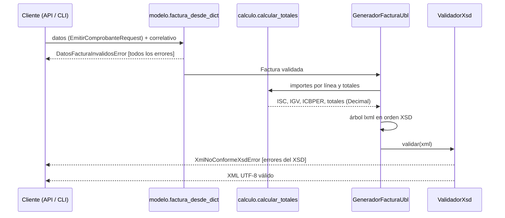

# Segundo parcial — Documentación técnica del generador XML UBL 2.1

**Proyecto**: Facturación electrónica SUNAT — ABC Software Corp  
**Feature**: [0008 — Generación del XML UBL 2.1](../specs/features/0008-generacion-xml-ubl/spec.md)  
**Fecha**: 2026-11-11

---

## 1. Descripción del caso

ABC Software Corp, una distribuidora de abarrotes, debe emitir facturas y boletas electrónicas. El comprobante electrónico es un documento XML con la estructura UBL 2.1 que exige SUNAT. La descripción completa (problema, contexto técnico, codificación y categorías tributarias) está en [`descripcion-del-caso-xml.md`](descripcion-del-caso-xml.md).

## 2. Objetivo

Generar, a partir de los datos de un comprobante, un XML `Invoice` UBL 2.1 **válido contra el XSD oficial** y con los códigos y cálculos de SUNAT, y comprobarlo con pruebas unitarias de generación.

> **Nota**: las secciones 3 a 8 describen el generador con el que se definieron las reglas (prototipo en Python, ADR-005). La **implementación principal es el adaptador Java con JAXB** (ADR-006), descrita en la sección 9; aplica las mismas reglas y produce el mismo XML (regresión cruzada).

## 3. Tecnologías utilizadas

| Tecnología | Uso | Justificación |
|---|---|---|
| **Python 3.10+** | Lenguaje del generador | Aporta `decimal` para importes exactos y `pytest`; ya era el lenguaje de las pruebas del proyecto (ADR-005). |
| **lxml ≥ 5** | Construcción del árbol XML y validación XSD (libxml2) | Valida contra el XSD real (libxml2) sin servicios externos. |
| **decimal** (biblioteca estándar) | Importes exactos | Evita los errores de redondeo de `float`, como pidió el docente. |
| **pytest ≥ 8** | Pruebas unitarias | Ya era el ejecutor de pruebas del proyecto. |
| **XSD OASIS UBL 2.1 OS** | Esquema de validación | Fuente normativa del XML (ver §6.1). |
| **Git / GitHub** | Versionado | Repositorio del curso. |

No se usa base de datos en este parcial. No se agregó ninguna dependencia aparte de `lxml`.

## 4. Funcionamiento del generador

### 4.1 Estructura del código

```
src/facturacion_xml/
├── __init__.py         ← API pública: generar_xml_factura(datos, correlativo, regimen_igv)
├── __main__.py         ← línea de comandos (lectura UTF-8, detección de WIN1252)
├── catalogos.py        ← catálogos SUNAT, categorías 1001-1004, tasas de IGV, ICBPER por año
├── modelo.py           ← DTO → Factura, con validación de la entrada
├── calculo.py          ← importes con Decimal (ISC → IGV → ICBPER)
├── generador_ubl.py    ← árbol XML Invoice en el orden del XSD
├── validador_xsd.py    ← compila UBL-Invoice-2.1.xsd y valida
├── numero_letras.py    ← leyenda 1000 (importe en letras)
└── errores.py          ← DatosFacturaInvalidosError, XmlNoConformeXsdError, EsquemaXsdIncompletoError
```

### 4.2 Flujo



### 4.3 Entrada

La entrada sigue el DTO `EmitirComprobanteRequest` del contrato [`facturacion-api.yaml`](../specs/contracts/facturacion-api.yaml): importes como texto decimal (`"140.00"`), unidades del Catálogo 03 y afectación del Catálogo 07. El **correlativo no forma parte de los datos**: lo asigna la serie en el servidor y se pasa como parámetro. Ejemplo: [`ejemplos/factura-abarrotes.json`](ejemplos/factura-abarrotes.json).

### 4.4 Cálculo de importes

| Paso | Fórmula | Fuente |
|---|---|---|
| Valor de venta de la línea | `cantidad × valor_unitario` | Guía §37 |
| ISC sistema 01 (al valor) | `valor_venta × tasa_isc` | Catálogo 08 |
| ISC sistema 02 (específico) | `cantidad × monto_fijo_isc` | Catálogo 08 |
| ISC sistema 03 (PVP) | `(cantidad × PVP / (1 + tasa_igv)) × tasa_isc` | Catálogo 08, spec 0002 §5.4 |
| IGV (solo gravadas) | `(valor_venta + ISC) × tasa_igv` (18 % o 10 %) | Guía §27 |
| ICBPER | `bolsas × importe del año de emisión` (S/ 0.50 desde 2023) | Ley 30884 |
| Total valor de venta | Σ valor de venta de gravadas + exoneradas + inafectas (sin gratuitas) | Guía §23–26 |
| Importe total | total valor de venta + IGV + ISC + ICBPER | Guía |

Cada importe se redondea a 2 decimales (`ROUND_HALF_UP`) por línea, y los totales suman los valores ya redondeados. La excepción es el **precio unitario con tributos** (`PricingReference`, Catálogo 16 = `01`): se conserva con hasta 10 decimales (`(valor + ISC + IGV) / cantidad`), como admite la Guía, para que precio × cantidad reconstruya el importe de la línea (bolsa: 1.18 / 10 = `0.118`, no `0.12`).

## 5. Estructura del XML

Elementos generados, en el orden de la secuencia de `InvoiceType` del XSD. Ejemplo completo: [`ejemplos/F001-00000001.xml`](ejemplos/F001-00000001.xml).

| # | Elemento | Obligatorio en el XSD | Contenido | Fuente del valor |
|---|---|---|---|---|
| 1 | `cbc:UBLVersionID` | no | `2.1` | Guía p. 79 |
| 2 | `cbc:CustomizationID` | no | `2.0` | Guía p. 79 |
| 3 | `cbc:ProfileID` | no | `0101` (venta interna, catálogo 17/51) | Matriz 0005 §3 |
| 4 | `cbc:ID` | **sí** | `F001-00000001` (serie + correlativo) | RS 097-2012 |
| 5 | `cbc:IssueDate` | **sí** | `2026-11-11` | Entrada |
| 6 | `cbc:IssueTime` | no | `10:30:00` | Entrada |
| 7 | `cbc:InvoiceTypeCode` | no | `01` / `03` (Catálogo 01) | Entrada |
| 8 | `cbc:Note` | no | Leyenda 1000 (importe en letras); 1002 si todo es gratuito | Catálogo 52 |
| 9 | `cbc:DocumentCurrencyCode` | no | `PEN` / `USD` | Catálogo 02 |
| 10 | `cbc:LineCountNumeric` | no | número de líneas | Guía p. 5 |
| 11 | `cac:Signature` | no | referencia a la firma del emisor | Guía p. 80 |
| 12 | `cac:AccountingSupplierParty` | **sí** | RUC (`schemeID=6`), nombre comercial, razón social, ubigeo, código de establecimiento `0000`, dirección | Matriz 0005 §4 |
| 13 | `cac:AccountingCustomerParty` | **sí** | tipo y número de documento (Catálogo 06), razón social, dirección | Matriz 0005 §5 |
| 14 | `cac:PaymentTerms` | no | `FormaPago` + `Contado`/`Credito`; cuotas `Cuota001`… | RS 193-2020 |
| 15 | `cac:TaxTotal` | no | total de tributos + un `TaxSubtotal` por tributo presente | Guía §23–27 |
| 16 | `cac:LegalMonetaryTotal` | **sí** | `LineExtensionAmount`, `TaxInclusiveAmount`, `PayableAmount` | Matriz 0005 §12 |
| 17 | `cac:InvoiceLine` (1..n) | **sí** | ver tabla siguiente | Matriz 0005 §7–10 |

Cada `cac:InvoiceLine` lleva `cbc:ID`, `cbc:InvoicedQuantity` (`@unitCode` del Catálogo 03), `cbc:LineExtensionAmount`, `cac:PricingReference` (precio con tributos, `01`, o valor referencial, `02`), `cac:TaxTotal` (ISC, IGV o su tributo de categoría, e ICBPER), `cac:Item` (descripción y código) y `cac:Price` (valor unitario sin tributos; `0.00` en gratuitas).

**Tributos por categoría** (`cac:TaxSubtotal`):

| Categoría (clase) | Afectación (Cat. 07) | `TaxCategory/cbc:ID` | `TaxScheme` (Cat. 05) | `Percent` |
|---|---|---|---|---|
| 1001 Gravada | 10 | S | 1000 · IGV · VAT | 18.00 o 10.00 |
| 1002 Inafecta | 30 | O | 9998 · INAFECTO · FRE | 0.00 |
| 1003 Exonerada | 20 | E | 9997 · EXONERADO · VAT | 0.00 |
| 1004 Gratuita | 21, 31–37 | Z | 9996 · GRATUITO · FRE | 0.00 |
| ISC | (con gravada) | S | 2000 · ISC · EXC + `TierRange` (Cat. 08) | tasa ISC |
| ICBPER | (cualquiera) | — | 7152 · ICBPER · OTH + `PerUnitAmount` | — |

**Qué no se genera y por qué**: `ext:UBLExtensions` (lo agrega el firmador; es opcional en el XSD). Aunque el bloque no se genera, la raíz **sí declara** los prefijos `ext`, `ds`, `ccts`, `qdt`, `udt` y `xsi` (como la Guía XML de SUNAT): el firmador de un OSE inserta `ext:UBLExtensions` en el XML y, si el prefijo no está declarado, responde con el error 0306 (*The prefix "ext" for element "ext:UBLExtensions" is not bound*). Hallazgo de la prueba en probar-xml.nubefact.com (E-15) y `sac:AdditionalMonetaryTotal` (era de UBL 2.0; no existe en el XSD de UBL 2.1).

## 6. Validación mediante XSD

### 6.1 Procedencia y versión del esquema

| Dato | Valor |
|---|---|
| Esquema | OASIS Universal Business Language (UBL) **2.1 OS** (*OASIS Standard*), publicado el 04-nov-2013 |
| Fuente oficial | <https://docs.oasis-open.org/ubl/os-UBL-2.1/xsd/> (`maindoc/` y `common/`) |
| Documento raíz | `docs/referencias/ubl/UBL-Invoice-2.1.xsd` |
| Archivos | 14 XSD; lista y SHA-256 en [`docs/referencias/ubl/README.md`](referencias/ubl/README.md) |

**Hallazgo**: el proyecto original tenía 11 de los 14 archivos. Faltaban `UBL-xmldsig-core-schema-2.1.xsd`, `UBL-XAdESv132-2.1.xsd` y `UBL-XAdESv141-2.1.xsd`, que importa la parte de firma (`UBL-CommonSignatureComponents` → `UBL-SignatureAggregateComponents`). Sin ellos, el XSD de Invoice **no compila**:

```
The QName value '{http://www.w3.org/2000/09/xmldsig#}Signature' does not resolve to a(n) element declaration.
```

Se incorporaron las copias de la versión OS (su cabecera dice *UBL 2.1 OS, Release Date: 04 November 2013*) tomadas del repositorio público `thegreenter/ubl-validator`, cuyos otros 10 archivos comunes son idénticos byte a byte a los que ya tenía el proyecto. Para confirmar que son iguales a los de OASIS, ejecuta en PowerShell:

```powershell
$base = "https://docs.oasis-open.org/ubl/os-UBL-2.1/xsd/common"
foreach ($f in "UBL-xmldsig-core-schema-2.1.xsd","UBL-XAdESv132-2.1.xsd","UBL-XAdESv141-2.1.xsd") {
  Invoke-WebRequest "$base/$f" -OutFile "$env:TEMP\$f"
  "{0}  {1}" -f (Get-FileHash "$env:TEMP\$f").Hash, (Get-FileHash "docs\referencias\ubl\$f").Hash
}
```

Si los dos hashes de cada línea coinciden, el archivo es el oficial.

### 6.2 Cómo se valida

`ValidadorXsd` compila `UBL-Invoice-2.1.xsd` una sola vez (caché) con lxml. Un *resolver* traduce los `schemaLocation` (`../common/...`) a los archivos de la carpeta local, sin acceso a red. `GeneradorFacturaUbl.generar()` valida **cada** XML antes de devolverlo; si el XSD lo rechaza, lanza `XmlNoConformeXsdError` con la línea y el mensaje de cada error. Si falta un archivo del esquema, lanza `EsquemaXsdIncompletoError` indicando cuál falta.

### 6.3 Qué valida el XSD y qué valida el dominio

| Lo valida el XSD | Lo valida el dominio (`modelo.py`) |
|---|---|
| Nombres y espacios de nombres de los elementos | Catálogos SUNAT (01, 02, 03, 06, 07, 08) |
| Orden de las secuencias | RUC con módulo 11, serie `^[FB][A-Z0-9]{3}$` coherente con el tipo |
| Obligatoriedad UBL (`ID`, `IssueDate`, partes, totales, líneas) | Obligatoriedad SUNAT (ubigeo, razón social, etc.) |
| Tipos de dato (fecha, decimal, código) | Reglas de negocio (ISC por sistema, cuotas, boleta > S/ 700) |

## 7. Pruebas unitarias realizadas

La verificación tiene tres niveles: pruebas unitarias de generación (§7.1), verificación integral con oráculos independientes (§7.2) y pruebas de mutación que demuestran que las pruebas detectan errores (§7.3).

### 7.1 Pruebas unitarias de generación

Archivo: [`tests/test_generador_xml.py`](../tests/test_generador_xml.py) — **89 pruebas** en 9 grupos.

| Grupo | Qué verifica | Pruebas |
|---|---|---|
| `TestGeneracion` | Se genera el XML en UTF-8, es válido contra el XSD, se genera el archivo por la línea de comandos y **`generar()` rechaza un XML que no cumple el XSD antes de entregarlo** | 5 |
| `TestEstructura` | Cabecera obligatoria, elementos requeridos, **orden de la secuencia**, atributos de catálogos, ausencia de elementos ajenos a UBL 2.1, un subtotal por tributo | 6 |
| `TestDatosEnEtiquetas` | Emisor, receptor, línea gravada, totales y cuadre en su etiqueta | 4 |
| `TestCategoriasDeOperacion` | 1001–1004 con su tributo; sin IGV en no gravadas; gratuita con valor referencial; leyenda 1002; IGV 10 % solo con el régimen | 10 |
| `TestIscEIcbper` | ISC sistemas 01, 02 y 03; ISC en la base del IGV; ICBPER por fecha (2026: 0.50; 2022: 0.40) | 5 |
| `TestFormatos` | Fecha, hora, 2 decimales, `currencyID`; tildes y ñ en UTF-8; BOM; rechazo de WIN1252; boleta con DNI; crédito con cuotas; dólares | 7 |
| `TestDatosInvalidos` (negativas) | Campos faltantes, sin líneas, RUC inválido, serie (incluido `F\|01`), correlativo, correlativo enviado por el cliente, unidad `SACO`, cantidades, `float`, factura sin RUC, ISC incompleto o en no gravada, afectaciones fuera de alcance, nota de crédito, cuotas, boleta > 700, numeración y reporte conjunto | 30 |
| `TestValidacionXsd` (negativas) | El XSD detecta un elemento obligatorio faltante, el orden alterado, un elemento inexistente, un tipo de dato incorrecto, XML mal formado y un esquema incompleto | 6 |
| `TestUtilidades` | RUC módulo 11 (incluido un RUC real de SUNAT) e importe en letras | 16 |

Además, `tests/test_contratos.py` (16 pruebas) sigue validando el contrato OpenAPI, los enlaces y que `src/` solo contenga el generador autorizado.

### 7.2 Verificación integral

Archivo: [`tests/test_verificacion_integral.py`](../tests/test_verificacion_integral.py) — **310 pruebas**. Comprueban el proyecto con oráculos que no dependen del código verificado:

| Grupo | Qué verifica | Pruebas |
|---|---|---|
| Coherencia contrato ↔ código | Los enums del contrato (Catálogos 03, 07, 08 y tipos de comprobante) coinciden con el generador; el ejemplo `POST /comprobantes` del contrato produce **los mismos importes** que su respuesta `201`; todos los RUC de ejemplo pasan el módulo 11 | 6 |
| Propiedades (300 comprobantes aleatorios, semilla fija) | Válidos contra el XSD; ID y número de líneas; una sola moneda; **recálculo independiente** de valor de venta, ISC, IGV e ICBPER leyendo solo el XML; precio × cantidad reconstruye la línea; cuadre de cabecera; subtotales de cabecera = suma de los de línea; importe en letras | 300 |
| Regresión | El ejemplo versionado `F001-00000001.xml` es idéntico a la generación actual; la generación es determinista y no modifica la entrada | 3 |
| Trazabilidad | Cada elemento que emite el generador figura en la matriz 0005 | 1 |

### 7.3 Pruebas de mutación

Script: [`tests/mutacion.py`](../tests/mutacion.py). Introduce **16 errores realistas** en el generador, uno por vez (IGV sin el ISC en su base, tasa equivocada, elementos fuera de orden, generar sin validar contra el XSD, RUC sin dígito verificador, ICBPER fijo, redondeo bancario, gratuitas sumadas al total, correlativo sin ceros, lectura que corrompe WIN1252, precio redondeado, ISC 03 mal calculado, tributo equivocado en gratuitas, afectación no soportada aceptada, etc.), y ejecuta la suite completa. Resultado: **16 de 16 detectados**. Salida en [`resultados-pruebas-python.txt`](resultados-pruebas-python.txt).

Ejecución:

```powershell
pip install -r requirements.txt
pytest -v
```

## 8. Resultados obtenidos

| Verificación | Resultado | Evidencia |
|---|---|---|
| `pytest -v` (suite completa: generador + verificación + contratos, con `openapi-spec-validator` 0.9.0 real) | **471 aprobadas, 0 fallidas** | [`resultados-pruebas-python.txt`](resultados-pruebas-python.txt) (Windows 11, Python 3.12.7) |
| `python tests/mutacion.py` | **16 de 16 mutantes detectados** | [`resultados-pruebas-python.txt`](resultados-pruebas-python.txt) |
| XML de ejemplo con las 4 categorías, ISC e ICBPER | Válido contra `UBL-Invoice-2.1.xsd` | [`ejemplos/F001-00000001.xml`](ejemplos/F001-00000001.xml) |
| Cuadre del ejemplo | Valor de venta 1 955.50 + tributos 386.85 = **2 342.35** | §8.1 |

> **Nota**: la suite completa se ejecutó el 2026-11-11 en la PC del equipo, sin dependencias simuladas y con `openapi-spec-validator` real. Los 3 XSD de firma agregados se compararon con los publicados en `docs.oasis-open.org` y sus SHA-256 coinciden byte a byte (ver `docs/referencias/ubl/README.md`).

### 8.1 Cuadre del ejemplo (`factura-abarrotes.json`)

| Línea | Categoría | Valor venta | ISC | IGV | ICBPER |
|---|---|---:|---:|---:|---:|
| 1 Arroz (10 × 140.00) | 1001 | 1 400.00 | — | 252.00 | — |
| 2 Aceite (5 × 80.00) | 1001 | 400.00 | — | 72.00 | — |
| 3 Bolsa (10 × 0.10, 10 bolsas) | 1001 | 1.00 | — | 0.18 | 5.00 |
| 4 Cerveza (24 × 4.50, ISC 01 al 30 %) | 1001 | 108.00 | 32.40 | 25.27 | — |
| 5 Exonerado (3 × 7.50) | 1003 | 22.50 | — | 0.00 | — |
| 6 Inafecto (2 × 12.00) | 1002 | 24.00 | — | 0.00 | — |
| 7 Muestra gratuita (5 × 1.20, referencial) | 1004 | *(6.00)* | — | 0.00 | — |
| **Total** | | **1 955.50** | **32.40** | **349.45** | **5.00** |

Total de tributos: 32.40 + 349.45 + 5.00 = **386.85**. Importe a pagar: 1 955.50 + 386.85 = **2 342.35**. Las tasas de ISC de los ejemplos son **ilustrativas**, no normativas.

## 9. Limitaciones y puntos por verificar

- Las afectaciones `11`–`17` (gravadas gratuitas, IVAP) y `40` (exportación) se rechazan con un error explícito: quedan fuera de este parcial.
- La estructura de las líneas gratuitas, los códigos del ICBPER y la numeración de cuotas siguen la matriz 0005 y la Guía XML v1.0 (2017). Deben contrastarse con el anexo de validaciones vigente de SUNAT ([`pendientes-verificacion.md`](pendientes-verificacion.md)).
- La vigencia del IGV del 10 % para restaurantes y hoteles se toma como regla vista en clase; por eso es un parámetro y no se aplica por defecto.
- El PVP del ISC sistema 03 se usa en el cálculo, pero no se escribe en el XML, porque la guía no indica en qué elemento va.

## 9. Implementación principal en Java (JAXB)

**Decisión**: [ADR-0006](../specs/adr/0006-generador-ubl-java-jaxb.md). **Código**: [`generador-java/`](../generador-java/).

### 9.1 Estructura

```
generador-java/src/main/java/pe/abc/facturacion/
├── Aplicacion.java                      ← línea de comandos
├── dominio/                             ← sin dependencias externas
│   ├── catalogo/   Catalogos, ClaseComprobante, CategoriaOperacion, SistemaCalculoIsc, RegimenIgv, TributoUbl…
│   ├── modelo/     Modelo (Factura, LineaFactura, Emisor, Receptor, FormaPago, Cuota)
│   ├── validacion/ LectorFactura (reglas), ValidadorRuc (módulo 11)
│   ├── calculo/    CalculadoraTributaria (ISC → IGV → ICBPER), ImportesLinea, Totales
│   ├── error/      DatosFacturaInvalidosException, XmlNoConformeXsdException, …
│   └── NumeroLetras
├── aplicacion/
│   ├── puerto/GeneradorXmlUblPort       ← puerto de salida
│   └── GenerarFacturaXmlService         ← caso de uso
└── infraestructura/
    ├── ubl/     GeneradorUblJaxbAdapter (clases JAXB del XSD) · ValidadorXsd (esquema XML)
    └── entrada/ LectorJson (UTF-8 estricto) · EsquemaEntrada (forma: JSON Schema)
```

### 9.2 Cómo se genera desde el XSD

1. Maven copia los XSD de `docs/referencias/ubl/` a `target/xsd-ubl/{maindoc,common}` (la estructura que esperan sus `schemaLocation`).
2. `jaxb-maven-plugin` ejecuta xjc sobre `UBL-Invoice-2.1.xsd` y genera ≈ 1 240 clases (`InvoiceType`, `TaxSubtotalType`, `InvoiceLineType`…) con el orden de campos de cada `xsd:sequence`.
3. `GeneradorUblJaxbAdapter` llena esos objetos con los importes del `CalculadoraTributaria` y los serializa con JAXB (`cac:` y `cbc:` como prefijos, `Invoice` como espacio por defecto).
4. `ValidadorXsd` valida el resultado contra el XSD oficial **antes de entregarlo**; si no cumple, no se entrega.

### 9.3 Los tres controles de la entrada

| Control | Qué valida | Dónde |
|---|---|---|
| Forma | La forma de los datos (JSON Schema 2020-12) | `specs/schemas/factura-entrada.schema.json` vía `EsquemaEntrada` |
| Reglas | Reglas de dominio: RUC módulo 11, boleta > S/ 700, suma de cuotas, ISC por sistema | `LectorFactura` |
| Esquema XML | El XML contra `UBL-Invoice-2.1.xsd` | `ValidadorXsd` |

### 9.4 Pruebas (Java)

| Prueba | Qué demuestra |
|---|---|
| `GeneradorFacturaXmlTest` (23) | Pruebas unitarias de generación por XPath: cabecera, emisor/receptor, totales, un `TaxSubtotal` por tributo, categorías 1001–1004, ISC, ICBPER, crédito con cuotas, USD, orden de la cabecera y que no se entrega un XML inválido. |
| `RegresionCruzadaTest` (7) | El XML Java es **el mismo documento** que el del prototipo Python para los 5 ejemplos. |
| `ValidadorXsdTest` (10) | El XSD detecta elementos faltantes, inexistentes, fuera de orden, tipos y atributos inválidos, y se identifica un esquema incompleto. |
| `LectorFacturaTest` (24) | Las reglas de dominio, con los 12 ejemplos inválidos de `specs/ejemplos/invalidos`. |
| `CalculoDeImportesTest` (22) | IGV, ISC de los 3 sistemas, gratuitas, ICBPER por año, redondeo y exactitud decimal. |
| `EntradaTest` (23) | Lectura UTF-8/BOM/WIN1252 y el JSON Schema contra todos los ejemplos. |
| `AplicacionTest` (7) | Línea de comandos y códigos de salida. |
| `RucYNumeroLetrasTest` (29) | RUC, importe en letras y catálogos. |
| `DependenciasEntreCapasTest` (7) | ArchUnit: dominio sin dependencias, solo el adaptador usa las clases del XSD, sin ciclos. |

**Resultado**: 162 pruebas, 0 fallos, cobertura de líneas 97 % del código propio (mínimo exigido: 90 %). Salida completa en [`resultados-pruebas-java.txt`](resultados-pruebas-java.txt).

### 9.5 Ejecución

```powershell
cd generador-java
.\mvnw.cmd verify
```

Solo requiere JDK 21. La primera vez descarga Maven y las dependencias.
