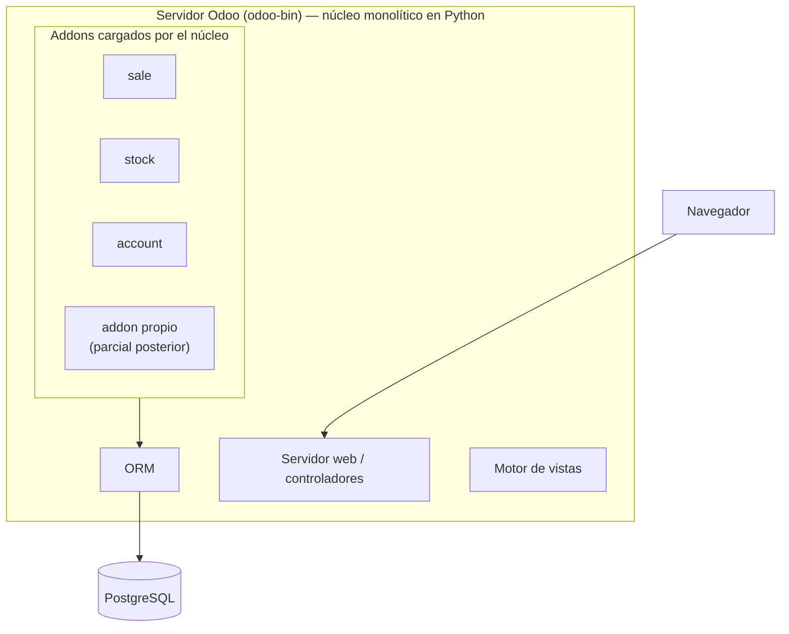

# Segundo parcial — Descripción del caso

**Curso**: Arquitectura de Software · UNAS – FIIS · Grupo A  
**Alumno**: Jorge Steven Tapullima Villar  
**Fecha**: 2026-11-11  
**Requisito**: 1 — Descripción del caso

---

## 1. Problema que se busca resolver

**ABC Software Corp** comercializa abarrotes al por mayor y menor. Su software actual solo registra fichas de almacén (`fecha`, `ingreso`, `salida`, `producto`, `nro_documento`). No emite comprobantes electrónicos: no valida el RUC, no calcula el IGV, el ISC ni el ICBPER, y no genera el documento XML que exige SUNAT.

La **RS N° 097-2012/SUNAT** obliga a emitir la factura y la boleta como documentos electrónicos en XML con la estructura del estándar internacional **UBL 2.1** (Universal Business Language, OASIS). Sin ese XML no hay comprobante: no se puede firmar, enviar al OSE ni obtener la constancia de recepción (CDR).

El primer parcial dejó especificado el sistema (fase Spec-First): casos de uso, modelo de dominio, arquitectura, contrato API y la matriz de trazabilidad SUNAT ↔ UBL. **Este parcial implementa la primera pieza ejecutable: el generador del XML.**

## 2. Contexto del sistema Odoo

El curso toma como referencia **Odoo**, un ERP de código abierto que incluye, entre otros, los módulos de ventas, inventario y contabilidad que necesita una empresa como ABC.

### 2.1 Arquitectura: núcleo monolítico extensible mediante addons

Hay que distinguir dos cosas:

- **El núcleo de Odoo es monolítico.** Una sola aplicación servidor (`odoo-bin`, en Python) contiene el ORM, el servidor web, el motor de vistas, la seguridad y el registro de modelos. Puede lanzar varios procesos trabajadores, pero todos ejecutan el mismo código y se despliegan como una unidad.
- **La extensibilidad se logra mediante módulos (addons).** Cada addon es una carpeta con un manifiesto (`__manifest__.py`), modelos en Python, vistas en XML y datos. Al instalarlo, el núcleo lo carga en su propio proceso y registro de modelos: el addon puede crear modelos o heredar los existentes y, a través del ORM, lee y escribe en la base de datos. Como el código fuente es abierto, se puede descargar un addon, modificarlo y extenderlo.

Por eso Odoo no es una arquitectura de microservicios ni de plugins aislados: los addons **extienden un monolito** y comparten su proceso y su base de datos.



### 2.2 Componentes

| Componente | Función |
|---|---|
| **Servidor Odoo** | Actúa como servidor web (HTTP) y puede ejecutarse como servicio del sistema operativo. |
| **PostgreSQL** | Sistema gestor de base de datos de Odoo; cada empresa o instancia usa su propia base. |
| **Python** | Lenguaje principal de Odoo y de sus addons. |
| **Git** | Herramienta para obtener, administrar y versionar el código fuente de Odoo y de los addons. |

**Instalación por binarios vs. desde el código fuente.** El instalador (binario o paquete) trae Odoo listo para usar, con sus dependencias, y lo registra como servicio; es la vía para usar el sistema. La instalación desde el repositorio (clonar con Git, instalar las dependencias de Python y ejecutar `odoo-bin` apuntando a PostgreSQL) es la vía para **desarrollar**: permite leer y modificar el núcleo y los addons. *Los pasos de esta instalación corresponden al tercer parcial y no se desarrollan aquí.*

### 2.3 Codificación de caracteres

UTF-8 es la codificación más usada y la que exige el XML de SUNAT. En Windows es frecuente WIN1252 (también llamada ANSI o Latin-1 occidental), que representa la "ñ" y las tildes con bytes distintos. Si un archivo en WIN1252 se lee como UTF-8, o si los datos de entrada no coinciden con la codificación de la base de datos de PostgreSQL, aparecen errores o caracteres corruptos ("Costeño" en lugar de "Costeño").

En este parcial **no se usa base de datos**, así que no se cambia la codificación de ninguna. El generador:

- lee la entrada **siempre** como UTF-8, acepta el BOM que agrega el Bloc de notas y, si el archivo está en WIN1252, lo rechaza con un mensaje claro en vez de corromper los datos;
- escribe el XML en UTF-8 con su declaración (`<?xml version="1.0" encoding="UTF-8"?>`).

## 3. Necesidad de generar documentos XML

En la facturación electrónica peruana, el comprobante **es** el XML. La representación impresa (PDF) es solo una copia. El XML debe:

1. cumplir la estructura del XSD oficial `UBL-Invoice-2.1.xsd` (orden, nombres y tipos de los elementos);
2. llevar los códigos de los catálogos de SUNAT (tipo de documento, moneda, unidad de medida, tributos, afectación del IGV, sistema del ISC);
3. cuadrar sus importes (valor de venta + tributos = importe total);
4. firmarse y enviarse al OSE o a SUNAT (pasos posteriores).

## 4. Relación con la facturación electrónica peruana

| Concepto visto en clase | Cómo se refleja en el XML UBL 2.1 |
|---|---|
| **1001 Gravada** | `TaxSubtotal` con tributo `1000` IGV (categoría `S`). IGV del **18 %**, o del **10 %** solo cuando se indica el régimen de restaurantes y hoteles visto en clase. |
| **1002 Inafecta** | `TaxSubtotal` con tributo `9998` INAFECTO (categoría `O`), sin IGV. |
| **1003 Exonerada** | `TaxSubtotal` con tributo `9997` EXONERADO (categoría `E`), sin IGV. |
| **1004 Gratuita** | `TaxSubtotal` con tributo `9996` GRATUITO (categoría `Z`), valor referencial con `PriceTypeCode = 02`; no suma al importe a pagar. |

Los códigos 1001–1004 vienen del Catálogo 14 de SUNAT, que en UBL 2.0 iba en `sac:AdditionalMonetaryTotal`. **Ese elemento no existe en el XSD de UBL 2.1**, así que no se genera: en UBL 2.1 cada categoría se informa como un `TaxSubtotal` con su propio tributo (Guía XML SUNAT, §23–26). Las tasas del 18 % y del 10 % se tratan como parámetros (`RegimenIgv`), no como una regla universal.

## 5. Objetivo de la implementación

Implementar, en Python (el lenguaje de Odoo), un generador que convierta los datos de un comprobante en el XML `Invoice` UBL 2.1 que exige SUNAT, válido contra el XSD oficial, y comprobarlo con pruebas unitarias de generación.

## 6. Alcance del desarrollo

| Incluido en el segundo parcial | Fuera de alcance (parciales posteriores) |
|---|---|
| Factura (`01`) y boleta (`03`) de venta interna | Firma digital, envío al OSE y CDR |
| Categorías gravada, inafecta, exonerada y gratuita | Notas de crédito y débito, bajas, resúmenes |
| IGV 18 % / 10 %, ISC (3 sistemas), ICBPER | Levantar Odoo desde el repositorio (tercer parcial) |
| Contado y crédito con cuotas | Docker (tercer parcial) |
| Validación de la entrada y validación XSD | Arquitectura de plugins / addon (cuarto parcial) |
| Pruebas unitarias de generación | Integración con `l10n_pe_accounting_pro` (posterior) |

## 7. Funcionamiento esperado

```
JSON del comprobante ──► validación de datos ──► cálculo de importes ──► árbol XML UBL 2.1 ──► validación XSD ──► XML UTF-8
 (EmitirComprobanteRequest)  (errores por campo)    (ISC → IGV → ICBPER)     (orden del XSD)       (UBL-Invoice-2.1.xsd)
```

1. Se reciben los datos del comprobante (como en el contrato API) y el correlativo que asigna la serie.
2. Si falta un dato o es inválido, se informan **todos** los errores con la ruta del campo, por ejemplo `items[0].unidad_medida: 'SACO' no es un código del Catálogo 03`.
3. Se calculan los importes con decimales exactos.
4. Se construye el XML en el orden del XSD.
5. Se valida contra `UBL-Invoice-2.1.xsd`; si no cumple, no se entrega.
6. Se obtiene el XML listo para el firmador. Ejemplo: [`ejemplos/F001-00000001.xml`](ejemplos/F001-00000001.xml).

Uso:

```powershell
$env:PYTHONPATH = "src"
python -m facturacion_xml docs\segundo-parcial\ejemplos\factura-abarrotes.json salida\F001-00000001.xml --correlativo 1
```
