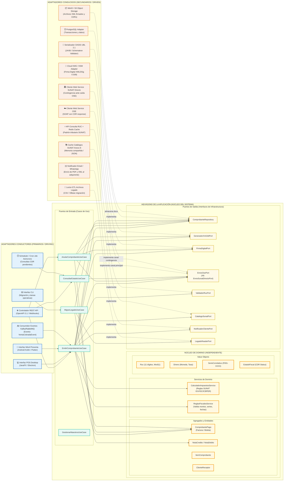
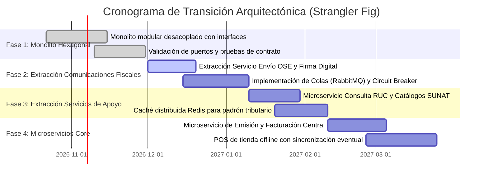

# Especificación Técnica: Arquitectura Monolito MVC y Transición Hexagonal

**Documento**: Arquitectura del Sistema de Facturación Electrónica  
**Carpeta**: `specs/02-arquitectura/`  
**Estado**: APROBADO  
**Autores**: Equipo Grupo A — UNAS-FIIS  
**Fecha**: 2026-10-22  
**Fuentes Normativas**: RS N° 097-2012/SUNAT (F-03), RS N° 234-2006/SUNAT (F-04), OASIS UBL 2.1 (F-01), Catálogos SUNAT Anexo 8 (F-02)

---

## 1. Visión General de la Arquitectura

Para **ABC Software Corp**, empresa del sector de abarrotes de alta rotación, el sistema de facturación electrónica se diseña bajo un principio fundamental de **aislamiento del núcleo de negocio frente a la volatilidad regulatoria y tecnológica**.

El sistema inicia como un **Monolito Modular MVC Desacoplado**, en el cual la separación entre capas se garantiza estrictamente mediante **Puertos e Interfaces** (principios SOLID, Inversión de Dependencias - DIP). Esta estructura garantiza que la evolución hacia una **Arquitectura Hexagonal (Ports & Adapters)** y la eventual extracción de **microservicios** se logren reemplazando adaptadores de infraestructura sin alterar una sola línea de lógica de dominio ni de reglas de cálculo fiscal.

---

## 2. Diagrama Mermaid del Monolito MVC Actual

En el monolito inicial, los controladores atienden las interacciones de los distintos canales de usuario (desktop para cajeros de abarrotes, móvil para preventa y web para administración contable), delegando de inmediato a los **Servicios de Aplicación (Casos de Uso)**. El núcleo de **Dominio** define la lógica de negocio y las interfaces de salida (puertos), cuyas implementaciones concretas residen en la capa de **Infraestructura / Adaptadores**.

```mermaid
flowchart TD
    subgraph UI["Capa de Presentación / Vistas (Clientes)"]
        UI_Desktop["💻 Desktop POS (Cajeros Tienda)\nJavaFX / Electron / Terminal Térmico"]
        UI_Mobile["📱 Mobile App (Preventa / Repartidores)\nAndroid / Flutter"]
        UI_Web["🌐 Web Backoffice (Administración / Contabilidad)\nReact / SPA"]
        UI_CLI["⌨️ CLI / Batch Runner\nHerramienta de Migración Legado"]
    end

    subgraph Controllers["Capa de Controladores (MVC)"]
        C_Comprobante["ComprobanteController\n(REST / HTTP / Desktop Events)"]
        C_Anulacion["AnulacionBajaController\n(REST / HTTP)"]
        C_Consulta["ConsultaEstadoController\n(REST / Polling)"]
        C_Validacion["ContribuyenteController\n(REST / HTTP)"]
        C_Catalogos["CatalogoSunatController\n(REST / HTTP)"]
        C_CRUD["MaestrosController\n(Clientes, Productos, Series)"]
        C_Migracion["MigracionLegadoController\n(CLI / REST)"]
    end

    subgraph Application["Capa de Aplicación (Servicios / Casos de Uso)"]
        UC_Emitir["EmitirComprobanteService\n(CU-01 / CU-02)"]
        UC_Anular["AnularComprobanteService\n(CU-03 / CU-04 / CU-07)"]
        UC_Consultar["ConsultarEstadoService\n(CU-05 / CU-06)"]
        UC_BajaResumen["GestionarBajasResumenesService\n(CU-07 / CU-08)"]
        UC_ValidarRuc["ValidarContribuyenteService\n(CU-09)"]
        UC_Maestros["GestionarMaestrosService\n(CU-10 / CU-11 / CU-12)"]
        UC_Catalogos["ConsultarCatalogosService\n(CU-13)"]
        UC_Migrar["MigrarLegadoService\n(CU-14)"]
    end

    subgraph Domain["Capa de Dominio (Núcleo de Negocio)"]
        subgraph Entities["Entidades y Agregados"]
            E_Comprobante["ComprobantePago\n(Factura / Boleta)"]
            E_Nota["NotaModificatoria\n(Crédito / Débito)"]
            E_Item["ItemComprobante"]
            E_Tributo["TributoDesglosado\n(IGV 1000, ISC 2000, ICBPER 7152)"]
            E_Cliente["ClienteReceptor"]
            E_Serie["SerieCorrelativo"]
        end

        subgraph ValueObjects["Value Objects"]
            VO_RUC["Ruc / Dni (Validados)"]
            VO_Money["MontoMonetario (Moneda PEN/USD)"]
            VO_Estado["EstadoComprobante\n(EMITIDO, FIRMADO, ACEPTADO, RECHAZADO, DE_BAJA)"]
            VO_Hash["CodigoHashSha256"]
        end

        subgraph DomainServices["Servicios de Dominio"]
            DS_Calc["CalculadorImpuestosDomainService\n(Base, IGV 18%, ICBPER, Redondeo SUNAT)"]
            DS_Val["ValidadorReglasFiscalesDomainService\n(RS 097-2012, RS 234-2006)"]
        end

        subgraph PortsOut["Puertos de Salida (Interfaces)"]
            P_Repo["ComprobanteRepository"]
            P_Xml["GeneradorXmlUblPort"]
            P_Firma["FirmaDigitalPort"]
            P_Ose["EnvioOsePort\n(Alt: EnvioSunatDirectoPort)"]
            P_Ruc["ValidadorRucPort"]
            P_Cat["CatalogoSunatPort"]
            P_Legado["LegadoReaderPort"]
        end
    end

    subgraph Infrastructure["Capa de Infraestructura (Adaptadores Iniciales en Monolito)"]
        A_Repo["SqliteComprobanteRepository /\nPostgreSQLJdbcRepository"]
        A_Xml["FreemarkerXmlUblGeneratorAdapter\n(Plantillas UBL 2.1 XSD)"]
        A_Firma["LocalPkcs12XmlDsigAdapter\n(Almacén .p12 en disco local)"]
        A_Ose["OseSoapClientAdapter\n(Fallback: SunatDirectoSoapAdapter)"]
        A_Ruc["AlgoritmoModulo11PadronLocalAdapter\n(Validación RUC offline/sqlite)"]
        A_Cat["EmbeddedJsonCatalogoSunatAdapter\n(Tablas Anexo 8 estáticas en memoria)"]
        A_Legado["CsvLegacyFileReaderAdapter\n(Archivos planos del sistema antiguo)"]
    end

    %% Relaciones de control y dependencia
    UI_Desktop --> C_Comprobante
    UI_Mobile --> C_Comprobante
    UI_Web --> C_CRUD
    UI_Web --> C_Anulacion
    UI_Web --> C_Consulta
    UI_CLI --> C_Migracion

    C_Comprobante --> UC_Emitir
    C_Anulacion --> UC_Anular
    C_Consulta --> UC_Consultar
    C_Validacion --> UC_ValidarRuc
    C_Catalogos --> UC_Catalogos
    C_CRUD --> UC_Maestros
    C_Migracion --> UC_Migrar

    UC_Emitir --> DS_Calc
    UC_Emitir --> DS_Val
    UC_Emitir --> E_Comprobante
    UC_Emitir --> P_Repo
    UC_Emitir --> P_Xml
    UC_Emitir --> P_Firma
    UC_Emitir --> P_Ose
    UC_Emitir --> P_Ruc
    UC_Emitir --> P_Cat

    UC_Anular --> P_Repo
    UC_Anular --> P_Xml
    UC_Anular --> P_Firma
    UC_Anular --> P_Ose

    UC_Consultar --> P_Repo
    UC_Consultar --> P_Ose

    UC_Migrar --> P_Legado
    UC_Migrar --> UC_Emitir

    %% Inversión de dependencias (DIP): Los adaptadores implementan las interfaces del dominio
    A_Repo -.->|implementa| P_Repo
    A_Xml -.->|implementa| P_Xml
    A_Firma -.->|implementa| P_Firma
    A_Ose -.->|implementa| P_Ose
    A_Ruc -.->|implementa| P_Ruc
    A_Cat -.->|implementa| P_Cat
    A_Legado -.->|implementa| P_Legado

    classDef ui fill:#e1f5fe,stroke:#0288d1,stroke-width:2px;
    classDef controller fill:#ede7f6,stroke:#512da8,stroke-width:2px;
    classDef app fill:#e8f5e9,stroke:#388e3c,stroke-width:2px;
    classDef domain fill:#fff3e0,stroke:#f57c00,stroke-width:2px;
    classDef infra fill:#fbe9e7,stroke:#d84315,stroke-width:2px;

    class UI_Desktop,UI_Mobile,UI_Web,UI_CLI ui;
    class C_Comprobante,C_Anulacion,C_Consulta,C_Validacion,C_Catalogos,C_CRUD,C_Migracion controller;
    class UC_Emitir,UC_Anular,UC_Consultar,UC_BajaResumen,UC_ValidarRuc,UC_Maestros,UC_Catalogos,UC_Migrar app;
    class E_Comprobante,E_Nota,E_Item,E_Tributo,E_Cliente,E_Serie,VO_RUC,VO_Money,VO_Estado,VO_Hash,DS_Calc,DS_Val,P_Repo,P_Xml,P_Firma,P_Ose,P_Ruc,P_Cat,P_Legado domain;
    class A_Repo,A_Xml,A_Firma,A_Ose,A_Ruc,A_Cat,A_Legado infra;
```



---

## 3. Tabla de Puertos y Adaptadores

La siguiente matriz clasifica rigurosamente los puertos del sistema, distinguiendo entre **Puertos de Entrada (Driver / Inbound)**, que definen los casos de uso invocados por actores externos, y **Puertos de Salida (Driven / Outbound)**, que representan dependencias de infraestructura requeridas por el dominio.

| Nombre del Puerto | Tipo | Responsabilidad / Contrato | Adaptador Inicial (Monolito) | Adaptador Futuro (Hexagonal / Microservicios) |
|---|---|---|---|---|
| **`EmitirComprobanteUseCase`** | Entrada (Inbound) | Orquestar la creación, cálculo impositivo, persistencia, generación UBL 2.1, firma digital y despacho a OSE/SUNAT de Facturas (`01`) y Boletas (`03`). | `DesktopPosController` (JavaFX/Swing) y `RestApiComprobanteController` (Spring MVC / Express) en el mismo proceso. | `GrpcFacturacionEndpoint`, `EventConsumerAdapter` (Consumidor Kafka/RabbitMQ suscrito a `OrdenVentaPagadaEvent`), o API Gateway distribuido. |
| **`AnularComprobanteUseCase`** | Entrada (Inbound) | Coordinar la emisión de Notas de Crédito (`07`), Notas de Débito (`08`) y generación de Comunicaciones de Baja para comprobantes erróneos. | `DesktopAnulacionDialogController` y `AdminWebController` con llamadas directas en memoria a la capa de aplicación. | `RestAnulacionController` expuesto por un Microservicio de Cancelaciones o SAGA orchestrator ante devolución de mercadería. |
| **`ConsultarEstadoUseCase`** | Entrada (Inbound) | Consultar el estado legal y tributario de un comprobante, recuperar el CDR (Constancia de Recepción) y descargar XML/PDF. | `ConsultaCdrCronJobAdapter` (hilo background en monolito) y `DesktopConsultaViewController`. | `CdrWebhookController` (recepción asíncrona push desde OSE/SUNAT) y `ElasticsearchQueryAdapter` para analítica y auditoría en tiempo real. |
| **`MigrarLegadoUseCase`** | Entrada (Inbound) | Leer ventas históricas del sistema antiguo de abarrotes, transformar la estructura al modelo de dominio y re-emitir o registrar históricamente. | `CliMigracionCommandAdapter` (comando CLI ejecutado en consola local por el administrador). | `K8sBatchJobMigradorAdapter` o pipeline ETL en Cloud Run / Apache Spark conectado a Data Lakehouse. |
| **`ComprobanteRepository`** | Salida (Outbound) | Persistir y recuperar entidades de comprobantes, detalles de ítems, estado de CDR y firmas hash garantizando atomicidad transaccional. | `SqliteComprobanteRepository` (almacenamiento local para punto de venta) o `PostgreSqlJpaRepository` en base monolítica. | `PostgresDistributedRepository` con particionamiento por sucursal/mes y `BlobStorageCdrXmlAdapter` (S3/GCS/MinIO) para XML/CDR. |
| **`GeneradorXmlUblPort`** | Salida (Outbound) | Transformar el agregado `ComprobantePago` en un documento XML estricto bajo el estándar OASIS UBL 2.1 e incorporar namespaces SUNAT. | `FreemarkerXmlUblGeneratorAdapter` o `JAXBUblAdapter` ejecutado en memoria con plantillas locales. | `UblMicroserviceClientAdapter` (servicio independiente de serialización XML con pre-validación de esquema XSD y Schematron SUNAT). |
| **`FirmaDigitalPort`** | Salida (Outbound) | Aplicar la firma electrónica XMLDSig (RSA-SHA256) con certificado digital X.509 en el nodo `ext:UBLExtensions`, generando el digest y código Hash. | `LocalPkcs12XmlDsigAdapter` leyendo certificado `.pfx`/`.p12` desde sistema de archivos con contraseña en variables de entorno. | `CloudKmsHsmFirmaAdapter` (integración con Cloud KMS, AWS KMS o Hardware Security Module FIPS 140-2 L3 sin exponer claves en memoria). |
| **`EnvioOsePort`** *(con contingencia SUNAT)* | Salida (Outbound) | Enviar el paquete comprimido `.zip` (XML firmado) al web service SOAP del Operador de Servicios Electrónicos (OSE) y recibir CDR. Dispone de conmutación a SUNAT directo. | `NubefactSoapOseAdapter` / `EfactSoapAdapter` con clase interna `SunatSoapDirectoAdapter` para contingencia inmediata ante caída del OSE. | `AsyncOseQueuePublisherAdapter` (encolamiento en RabbitMQ/Kafka con Circuit Breaker, reintentos exponenciales y Dead Letter Queue fiscal). |
| **`ValidadorRucPort`** | Salida (Outbound) | Validar que el RUC del adquirente tenga 11 dígitos, dígito verificador correcto (módulo 11) y se encuentre en estado ACTIVO y HABIDO. | `SunatRucModulo11Adapter` con base de datos local SQLite conteniendo el padrón reducido de contribuyentes SUNAT. | `SunatConsultaRucApiAdapter` con capa de caché distribuida en Redis (TTL 24h) y fallback a API REST oficial de SUNAT. |
| **`CatalogoSunatPort`** | Salida (Outbound) | Proveer códigos y descripciones normativas del Anexo 8 (Tablas 01 a 25: tipo documento, afectación IGV, monedas, unidades de medida). | `EmbeddedJsonCatalogoSunatAdapter` leyendo archivos JSON estáticos empaquetados en el artefacto de la aplicación. | `CatalogoSunatDistributedAdapter` respaldado por Redis / ConfigServer centralizado, actualizable en caliente sin redesplegar. |
| **`LegadoReaderPort`** | Salida (Outbound) | Extraer registros de comprobantes antiguos, clientes y artículos desde archivos planos (CSV, TXT) o base de datos relacional heredada. | `CsvLegacyFileReaderAdapter` / `DbfAccessFileReaderAdapter` procesando archivos del software contable previo de la empresa. | `CdcLegacyStreamAdapter` (Debezium + Kafka Connect) capturando cambios de base de datos legado en tiempo real hasta su apagado definitivo. |

---

## 4. Diagrama Mermaid de la Arquitectura Hexagonal Futura

En la arquitectura hexagonal objetivo, el **Dominio** se sitúa en el centro geométrico e intelectual del sistema. No tiene dependencias de ningún framework, base de datos ni protocolo de red. Los **Puertos** actúan como los bordes del hexágono y los **Adaptadores** se conectan desde el exterior respetando invariablemente la regla de dependencia: **las dependencias apuntan siempre hacia el centro**.



---

## 5. Ruta de Migración a Microservicios (Patrón Strangler Fig)

### 5.1 ¿Qué módulo se extrae primero y por qué?

**Decisión**: El primer módulo que se extrae del monolito es el **Servicio de Envío OSE / SUNAT y Firma Digital (Módulo de Comunicaciones Fiscales)**.

#### Justificación Técnica y Operativa:
1. **Volatilidad y Resiliencia Externa**: La comunicación con OSE o SUNAT vía SOAP sufre de alta latencia (de 800 ms a más de 30 segundos en horas pico de cierre contable) e indisponibilidad recurrente. Si esta lógica permanece sincrónica dentro del monolito en el punto de venta de abarrotes, la caída del servicio externo bloquea la cola de cobro de clientes en la tienda física. Al extraerlo a un microservicio respaldado por una **cola de mensajes (RabbitMQ/Kafka)**, la caja emite el comprobante en milisegundos en modo local/contingencia y delega el despacho al microservicio asíncrono con reintentos exponenciales y Circuit Breaker.
2. **Seguridad y Custodia Criptográfica**: La firma digital requiere acceso a la clave privada del certificado digital X.509. En el monolito, el archivo `.p12` o la clave residente en memoria se encuentra expuesta en múltiples estaciones de trabajo de cajeros. Aislar la firma en un microservicio de emisión centralizado permite encapsular la clave privada en un **Cloud KMS o HSM dedicado** con políticas IAM restrictivas.
3. **Escalabilidad Asimétrica**: Mientras que la gestión de maestros (productos, clientes) tiene una carga baja y predecible, la emisión de comprobantes y recepción de CDRs en fechas especiales de alta venta comercial (e.g. fin de mes, campañas) genera picos masivos de procesamiento XML y cálculo de hashes criptográficos. El microservicio de comunicaciones puede escalar horizontalmente en contenedores independientes (Kubernetes / Cloud Run) sin necesidad de replicar todo el monolito.

### 5.2 Fases de la Migración Progresiva



1. **Fase 1 — Monolito Modular Desacoplado**: Se implementan todos los módulos en una única base de código pero organizados estrictamente por paquetes que reflejan los puertos. Los controladores invocan interfaces de caso de uso y la infraestructura implementa puertos de salida. No hay llamadas estáticas cruzadas entre dominios.
2. **Fase 2 — Extracción del Servicio de Comunicaciones Fiscales y Firma**:
   - Se crea el microservicio `fiscal-dispatcher-service`.
   - El monolito reemplaza `OseSoapClientAdapter` y `LocalPkcs12XmlDsigAdapter` por un nuevo adaptador `RabbitMqOsePublisherAdapter`.
   - La capa de dominio y los casos de uso del monolito no sufren **ninguna modificación**.
3. **Fase 3 — Extracción de Consulta de Contribuyentes y Catálogos**:
   - Se extrae `sunat-masterdata-service` con base de datos Redis.
   - El monolito cambia el adaptador `EmbeddedJsonCatalogoSunatAdapter` por `RestCatalogoClientAdapter`.
4. **Fase 4 — Desacoplamiento Completo del POS de Tienda y Facturación Central**:
   - Las cajas de abarrotes funcionan como clientes offline-first (SQLite local) garantizando emisión ininterrumpida ante cortes de fibra óptica.
   - La sincronización hacia el backend de facturación central se realiza mediante mensajería eventual con garantía de entrega *at-least-once*.

---

## 6. Estructura de Paquetes Propuesta

La estructura demuestra cómo pasar de una organización MVC a una arquitectura Hexagonal **mantiene el dominio y la aplicación 100% intactos**, alterando exclusivamente la carpeta exterior de adaptadores de infraestructura.

### 6.1 Estructura en el Monolito Inicial (Organizado por Puertos)
```text
src/
└── facturacion/
    ├── domain/                               ← NÚCLEO INTACTO (Cero dependencias externas)
    │   ├── model/
    │   │   ├── ComprobantePago.java          ← Entidad raíz de agregado
    │   │   ├── Factura.java                  ← Subtipo con RUC y detracciones
    │   │   ├── BoletaVenta.java              ← Subtipo con DNI/sin doc
    │   │   ├── ItemComprobante.java          ← Detalle con precio unitario y código
    │   │   ├── Tributo.java                  ← IGV, ISC, ICBPER desglosados
    │   │   └── Cliente.java                  ← Datos de razón social y dirección fiscal
    │   ├── valueobjects/
    │   │   ├── Ruc.java                      ← Validación dígito verificador Módulo 11
    │   │   ├── SerieCorrelativo.java         ← Formato F001-00000001 según RS 097-2012
    │   │   ├── Dinero.java                   ← BigDecimal con 2 o 10 decimales según norma
    │   │   ├── TipoComprobante.java          ← Enum con valores de Catálogo 01
    │   │   └── EstadoComprobante.java        ← Enum: EMITIDO, FIRMADO, ACEPTADO, RECHAZADO
    │   ├── services/
    │   │   ├── CalculadorImpuestosService.java ← Fórmulas oficiales de base e IGV
    │   │   └── ValidadorReglasFiscales.java   ← Invariantes de negocio
    │   └── ports/                            ← PUERTOS DE SALIDA (INTERFACES)
    │       ├── ComprobanteRepository.java
    │       ├── GeneradorXmlUblPort.java
    │       ├── FirmaDigitalPort.java
    │       ├── EnvioOsePort.java
    │       ├── ValidadorRucPort.java
    │       ├── CatalogoSunatPort.java
    │       └── LegadoReaderPort.java
    │
    ├── application/                          ← CASOS DE USO INTACTOS
    │   ├── ports/in/                         ← PUERTOS DE ENTRADA (INTERFACES)
    │   │   ├── EmitirComprobanteUseCase.java
    │   │   ├── AnularComprobanteUseCase.java
    │   │   ├── ConsultarEstadoUseCase.java
    │   │   └── MigrarLegadoUseCase.java
    │   ├── dto/
    │   │   ├── EmitirFacturaRequest.java
    │   │   ├── ComprobanteResponse.java
    │   │   └── CdrResponseDto.java
    │   └── services/                         ← IMPLEMENTACIÓN DE CASOS DE USO
    │       ├── EmitirComprobanteService.java
    │       ├── AnularComprobanteService.java
    │       ├── ConsultarEstadoService.java
    │       └── MigrarLegadoService.java
    │
    └── infrastructure/                       ← ADAPTADORES MONOLITO (Sustituibles)
        ├── controllers/                      ← Adaptadores de Entrada Iniciales (MVC)
        │   ├── ComprobanteRestController.java
        │   ├── DesktopPosController.java
        │   ├── AnulacionBajaController.java
        │   └── MigracionCliController.java
        └── adapters/                         ← Adaptadores de Salida Iniciales
            ├── persistence/
            │   └── PostgresJdbcComprobanteRepository.java
            ├── ubl/
            │   └── FreemarkerXmlUblGeneratorAdapter.java
            ├── security/
            │   └── LocalPkcs12FirmaAdapter.java
            ├── ose/
            │   ├── SoapOseClientAdapter.java
            │   └── SoapSunatDirectoFallbackAdapter.java
            ├── sunat/
            │   ├── OfflineModulo11ValidadorRucAdapter.java
            │   └── InMemoryCatalogoSunatAdapter.java
            └── legado/
                └── CsvLegacyFileReaderAdapter.java
```

### 6.2 Estructura en la Arquitectura Hexagonal / Microservicios Evolucionada

Observe que las carpetas `domain/` y `application/` son **rigurosamente idénticas**. Solo se han agregado o sustituido los adaptadores en `infrastructure/`:

```diff
  src/facturacion/
  ├── domain/                             ← 100% IDÉNTICO SIN CAMBIOS
  │   ├── model/...
  │   ├── valueobjects/...
  │   ├── services/...
  │   └── ports/...
  ├── application/                        ← 100% IDÉNTICO SIN CAMBIOS
  │   ├── ports/in/...
  │   ├── dto/...
  │   └── services/...
  └── infrastructure/
      ├── controllers/                    ← Nuevos adaptadores de entrada
+     │   ├── GrpcFacturacionEndpoint.java
+     │   ├── KafkaVentaConsumer.java
+     │   ├── WebhookCdrController.java
-     │   └── DesktopPosController.java   (se convierte en cliente HTTP/gRPC externo)
      └── adapters/                       ← Nuevos adaptadores de salida distribuidos
          ├── persistence/
+         │   ├── DistributedPostgresRepository.java
+         │   └── S3XmlCdrStorageAdapter.java
-         │   └── PostgresJdbcComprobanteRepository.java
          ├── security/
+         │   └── CloudKmsHsmFirmaAdapter.java
-         │   └── LocalPkcs12FirmaAdapter.java
          ├── ose/
+         │   └── RabbitMqAsyncOsePublisherAdapter.java
-         │   └── SoapOseClientAdapter.java
          └── sunat/
+         │   ├── RedisCachedSunatRucAdapter.java
+         │   └── DistributedCatalogoSunatAdapter.java
-         │   └── OfflineModulo11ValidadorRucAdapter.java
```

---

## 7. Conclusión y Verificación contra Principios de Diseño

1. **Independencia del Framework**: El dominio no importa bibliotecas de Spring, JavaFX, AWS ni librerías SOAP propietarias.
2. **Facilidad de Pruebas Unitarias**: Los casos de uso pueden probarse exhaustivamente al 100% instanciando dobles de prueba (Mocks/Stubs) de las interfaces de puertos sin necesidad de levantar bases de datos ni servicios web de SUNAT.
3. **Conformidad Normativa SUNAT**: La lógica de cálculo tributario (IGV, ISC, ICBPER) y de validación de comprobantes se encuentra blindada dentro del dominio, aislada de fallos de red o cambios de versión de los proveedores OSE.
