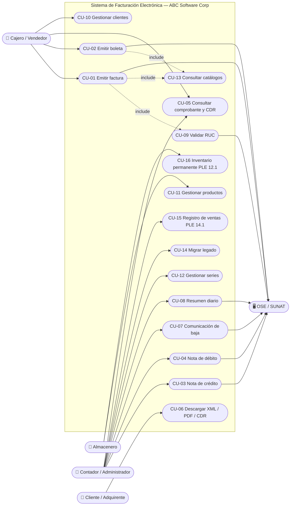

# design.md — 0001 Casos de Uso

**Feature**: Casos de Uso del Sistema de Facturación Electrónica  
**ID**: 0001  
**Estado**: EN REVISIÓN  
**Autor**: Gilmer Ayala Falcón (Grupo A, UNAS-FIIS)  
**Fecha**: 2026-11-11  
**Fuentes**: F-03, F-05, benchmark de Nubefact (cuenta DEMO)

---

## Contexto de diseño

La lista de casos de uso se obtuvo revisando las funciones de un software comercial de facturación electrónica (Nubefact, cuenta DEMO), como pide la sección 3 del enunciado, y contrastándolas con las obligaciones de SUNAT. El detalle de cada caso (precondiciones, flujos y reglas) está en [`spec.md`](spec.md). Este documento muestra **quién usa qué** y **cómo cada caso de uso llega a la arquitectura**: puerto de entrada ([0003](../0003-arquitectura-mvc-hexagonal/design.md)) y endpoint ([0004](../0004-contratos-api/design.md)).

## Benchmark: funciones de Nubefact → casos de uso

| Función observada en el software de referencia | Caso de uso del proyecto |
|---|---|
| Emitir factura / boleta desde un formulario | CU-01, CU-02 |
| Emitir nota de crédito o débito sobre un comprobante | CU-03, CU-04 |
| Ver listado de comprobantes con su estado SUNAT | CU-05 |
| Descargar PDF, XML y CDR | CU-06 |
| Anular (comunicación de baja) | CU-07 |
| Envío de resumen diario de boletas | CU-08 |
| Autocompletar datos del cliente al digitar el RUC | CU-09 |
| Mantenimiento de clientes, productos y series | CU-10, CU-11, CU-12 |
| Tablas SUNAT (unidades, afectación IGV, etc.) en los combos | CU-13 |
| *(no aplica a Nubefact: necesidad propia de ABC)* Migrar el sistema antiguo | CU-14 |
| Reportes / libros electrónicos | CU-15, CU-16 |

> ⚠️ Por verificar: la tabla resume funciones públicas del producto; no describe su implementación interna.

## Diagrama de casos de uso

## Trazabilidad caso de uso → puerto de entrada → endpoint

| CU | Puerto de entrada (0003) | Endpoints (0004, `facturacion-api.yaml`) |
|---|---|---|
| CU-01, CU-02 | `EmitirComprobanteUseCase` | `POST /comprobantes` |
| CU-03, CU-04 | `AnularComprobanteUseCase` | `POST /notas-credito`, `POST /notas-debito` |
| CU-05 | `ConsultarEstadoUseCase` | `GET /comprobantes`, `GET /comprobantes/{id}` |
| CU-06 | `ConsultarEstadoUseCase` | `GET /comprobantes/{id}/xml`, `/pdf`, `/cdr` |
| CU-07 | `AnularComprobanteUseCase` | `POST /comunicaciones-baja` |
| CU-08 | `EnviarResumenDiarioUseCase` | `POST /resumenes-diarios` |
| CU-09 | `ValidarContribuyenteUseCase` | `GET /contribuyentes/{ruc}/validar` |
| CU-10, CU-11, CU-12 | `GestionarMaestrosUseCase` | CRUD `/clientes`, `/productos`, `/series` |
| CU-13 | `GestionarMaestrosUseCase` | `GET /catalogos/{numero}` |
| CU-14 | `MigrarLegadoUseCase` | `POST /migraciones/legado`, `GET /migraciones/{id}`, `GET /migraciones/{id}/cuarentena`, `POST /migraciones/{id}/reprocesos` |
| CU-15, CU-16 | `GenerarLibrosElectronicosUseCase` | `GET /libros/registro-ventas`, `GET /libros/inventario-permanente` |

Cada uno de los 16 casos de uso tiene al menos un puerto y un endpoint. Las 33 operaciones del contrato citan su `CU-xx` en la descripción.

## Decisiones de diseño

### Baja y notas en un mismo puerto

**Problema**: CU-03, CU-04 y CU-07 modifican o anulan un comprobante ya aceptado.  
**Opción elegida**: un solo puerto, `AnularComprobanteUseCase`, que valida que el documento afectado esté `ACEPTADO` antes de cualquier operación.  
**Justificación**: la regla de “solo sobre comprobantes aceptados” vive en un único lugar.  
**ADR relacionado**: [`0001-monolito-mvc-desacoplado-mediante-puertos.md`](../../adr/0001-monolito-mvc-desacoplado-mediante-puertos.md)

### La migración no emite

**Problema**: CU-14 carga documentos históricos que podrían confundirse con ventas nuevas.  
**Opción elegida**: `MigrarLegadoUseCase` nunca invoca `EmitirComprobanteUseCase` ni `EnvioOsePort`.  
**Justificación**: evita reenviar a SUNAT documentos antiguos. Ver [0006](../0006-migracion-legado/spec.md), RF-MIG-01.

## Notas

> ⚠️ Por verificar: actores y frecuencias reales de uso con el personal de ABC Software Corp.
