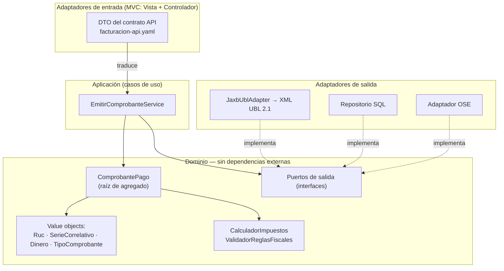
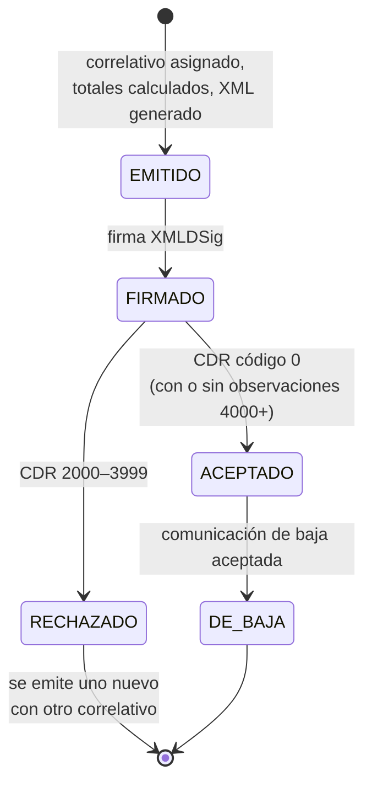

# design.md — 0002 Modelo de Dominio

**Feature**: Modelo de Dominio de Facturación Electrónica  
**ID**: 0002  
**Estado**: EN REVISIÓN  
**Autor**: Equipo Grupo A — UNAS-FIIS  
**Fecha**: 2026-11-11  
**Fuentes**: F-01, F-02, F-03, F-04

---

## Contexto de diseño

El modelo de dominio es el **núcleo** de la arquitectura ([0003](../0003-arquitectura-mvc-hexagonal/design.md)). No depende de frameworks, base de datos, UI ni del OSE: esa es la condición para que el monolito MVC pueda migrar a Hexagonal sin reescribirlo. Las entidades, value objects, invariantes y ejemplos numéricos están en [`spec.md`](spec.md). Aquí se documenta **cómo se separa el dominio de los contratos** y **el ciclo de vida del comprobante**.

## Decisiones de diseño

### Entidades separadas de los DTO

**Problema**: el contrato API (DTO en `components/schemas` de [`facturacion-api.yaml`](../../contracts/facturacion-api.yaml)) y el XML UBL tienen formas distintas a las del dominio.  
**Opción elegida**: tres modelos con traducción explícita: DTO ↔ dominio en el controlador (adaptador de entrada) y dominio ↔ UBL en `GeneradorXmlUblPort`.  
**Justificación**: un cambio en la API o en la versión de UBL no toca el dominio. La correspondencia campo a campo está en la matriz de [0005](../0005-trazabilidad-sunat-ubl/spec.md).  
**ADR relacionado**: [`0001-monolito-mvc-desacoplado-mediante-puertos.md`](../../adr/0001-monolito-mvc-desacoplado-mediante-puertos.md)

### Los impuestos los calcula el dominio, no el cliente

**Problema**: si la caja o el móvil envían IGV, ISC o totales, cada cliente podría calcularlos distinto.  
**Opción elegida**: el DTO de entrada solo trae cantidades, precios, afectación (Cat. 07) y datos del ISC (Cat. 08). `CalculadorImpuestos` obtiene bases, tributos y totales.  
**Justificación**: una sola implementación de las reglas de SUNAT; el contrato rechaza totales enviados por el cliente (ver [0004](../0004-contratos-api/spec.md)).

### Datos normativos versionados por fecha

**Problema**: la tasa de IGV, el importe del ICBPER y las tasas del ISC cambian con el tiempo.  
**Opción elegida**: se resuelven por **fecha de emisión** a través de `CatalogoSunatPort`, no como constantes.  
**Justificación**: los comprobantes antiguos se recalculan con la regla que regía en su fecha.

## Diagrama de capas del dominio

Las flechas de dependencia apuntan **hacia el dominio**; ningún elemento del dominio importa clases de los adaptadores.

## Ciclo de vida del comprobante

Reglas del diagrama (detalle en [`spec.md` §3.1](spec.md)):

- Un comprobante `RECHAZADO` nunca vuelve a `FIRMADO`.
- Las notas de crédito y débito y la baja solo se aplican sobre un comprobante `ACEPTADO`.
- Los registros migrados del sistema antiguo entran con `origen = LEGADO` y no recorren este ciclo: nunca se envían a OSE/SUNAT ([0006](../0006-migracion-legado/spec.md)).

## Componentes involucrados

| Componente | Capa | Responsabilidad |
|---|---|---|
| `ComprobantePago` (y `Factura`, `BoletaVenta`, notas) | Dominio | Raíz de agregado; protege las invariantes del comprobante. |
| `Ruc`, `SerieCorrelativo`, `Dinero`, `TipoComprobante` | Dominio | Value objects inmutables con su validación (módulo 11, formato de serie, decimal exacto, Cat. 01). |
| `CalculadorImpuestos` | Dominio | IGV, ISC según Cat. 08, ICBPER y totales con redondeo SUNAT. |
| `ValidadorReglasFiscales` | Dominio | Reglas de emisión: tipo de documento del receptor, umbral de boleta, coherencia de series. |
| `MovimientoAlmacen`, `Producto` | Dominio | Base del kardex (Registro de Inventario Permanente, RS 234-2006). |
| Puertos de salida | Dominio | Interfaces que implementan los adaptadores (repositorio, UBL, firma, OSE, catálogos). |

## Notas

> ⚠️ Por verificar: prefijos válidos del RUC y umbral de identificación en boletas (ver [`docs/pendientes-verificacion.md`](../../../docs/pendientes-verificacion.md)).
