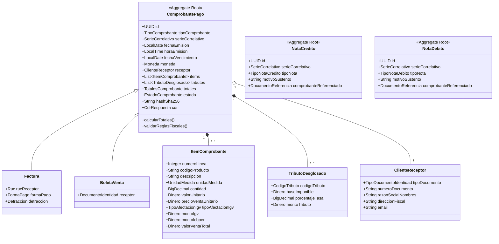

# spec.md — 0002 Modelo de Dominio

**Feature**: Modelo de Dominio de Facturación Electrónica  
**ID**: 0002  
**Estado**: APROBADO  
**Autor**: Equipo Grupo A — UNAS-FIIS  
**Fecha**: 2026-10-22  
**Fuentes**: RS 097-2012/SUNAT (F-03), RS 234-2006/SUNAT (F-04), OASIS UBL 2.1 (F-01), Catálogos SUNAT Anexo 8 (F-02)

---

## 1. Entidades y Agregados del Dominio

---

## 2. Value Objects e Invariantes Fiscales

1. **`Ruc`**:
   - Longitud exacta: 11 dígitos numéricos.
   - Prefijos válidos: `10` (persona natural con negocio), `15`, `17`, `20` (persona jurídica).
   - Invariante: El dígito 11 debe ser exactamente el resultado del algoritmo Módulo 11 con pesos ponderados `[5, 4, 3, 2, 7, 6, 5, 4, 3, 2]`.
2. **`SerieCorrelativo`**:
   - Serie: 4 caracteres alfanuméricos. Para Factura inicia con `F` (e.g. `F001`), para Boleta inicia con `B` (e.g. `B001`), para Nota de Crédito de Factura `FC01`, etc.
   - Correlativo: Número entero de 1 a 8 dígitos, formateado con ceros a la izquierda (e.g. `00000042`).
3. **`CalculadorImpuestos`**:
   - **Tasa IGV**: 18% (16% IGV + 2% IPM) aplicado sobre la base imponible de operaciones gravadas (Código Catálogo 07: `10`).
   - **ICBPER**: S/ 0.20 fijo por cada bolsa de plástico suministrada (Código Catálogo 05: `7152`).
   - **Cuadre contable**: `Total Venta = Total Valor Venta (Gravada + Exonerada + Inafecta) + Total IGV + Total ISC + Total ICBPER - Descuentos Globales`.
