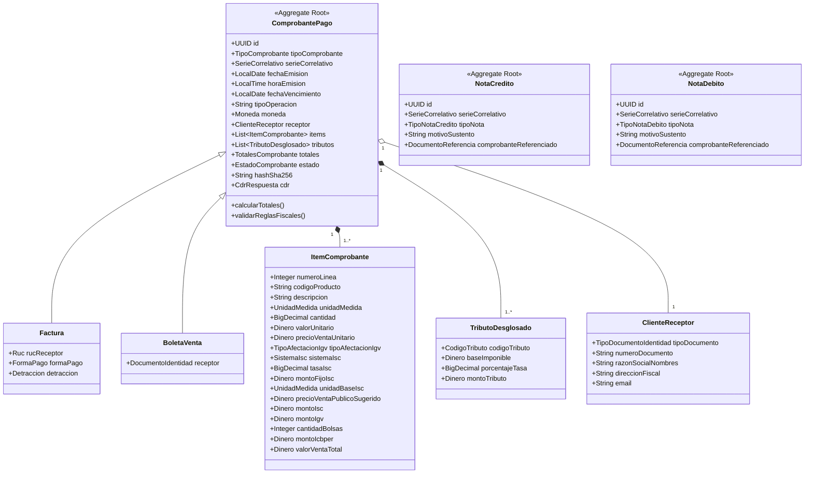
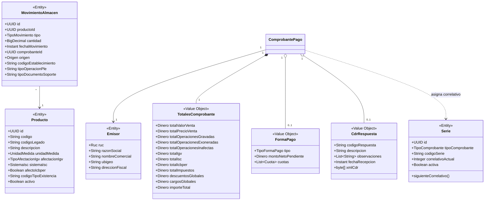
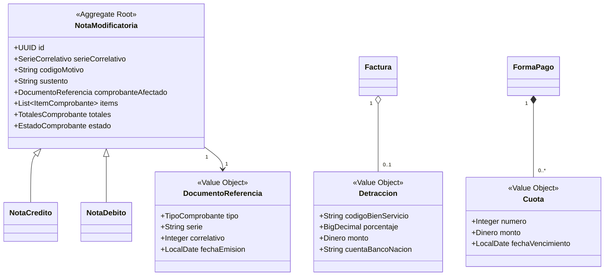

# spec.md — 0002 Modelo de Dominio

**Feature**: Modelo de Dominio de Facturación Electrónica  
**ID**: 0002  
**Estado**: EN REVISIÓN  
**Autor**: Equipo Grupo A — UNAS-FIIS  
**Fecha**: 2026-10-22  
**Fuentes**: RS 097-2012/SUNAT (F-03), RS 234-2006/SUNAT (F-04), OASIS UBL 2.1 (F-01), Catálogos SUNAT Anexo 8 (F-02)

---

## 1. Entidades y Agregados del Dominio

---

## 2. Value Objects e Invariantes Fiscales

1. **`Ruc`**:
   - Longitud exacta: 11 dígitos numéricos.
   - Prefijos válidos: `10` (persona natural con negocio), `15`, `16`, `17`, `20` (persona jurídica). ⚠️ Por verificar lista vigente [F-05].
   - Invariante: El dígito 11 debe ser exactamente el resultado del algoritmo Módulo 11 con pesos ponderados `[5, 4, 3, 2, 7, 6, 5, 4, 3, 2]`.
2. **`SerieCorrelativo`**:
   - Serie: 4 caracteres alfanuméricos. Para Factura inicia con `F` (e.g. `F001`), para Boleta inicia con `B` (e.g. `B001`), para Nota de Crédito de Factura `FC01`, etc.
   - Correlativo: Número entero de 1 a 8 dígitos, formateado con ceros a la izquierda (e.g. `00000042`).
3. **`CalculadorImpuestos`**:
   - **Tasa IGV**: 18% (16% IGV + 2% IPM) aplicado sobre la base imponible de operaciones gravadas (Código Catálogo 07: `10`).
   - **ICBPER**: importe fijo por cada bolsa de plástico suministrada (Código Catálogo 05: `7152`). El importe es **S/ 0.50 desde el 01/01/2023** (Ley N° 30884) y se obtiene por fecha de emisión desde `CatalogoSunatPort`; no es una constante del dominio.
   - **Cuadre contable**: `Total Venta = Total Valor Venta (Gravada + Exonerada + Inafecta) + Total IGV + Total ISC + Total ICBPER - Descuentos Globales`.

---

## 3. Entidades y Value Objects complementarios

El diagrama de la sección 1 omite las siguientes piezas, necesarias para trazar el DTO (`specs/contracts/facturacion-api.yaml`) y la matriz SUNAT/UBL (`specs/features/0005-trazabilidad-sunat-ubl/spec.md`).

### 3.1 Estados del comprobante (`EstadoComprobante`)

| Estado | Significado | Transiciones permitidas |
|---|---|---|
| `EMITIDO` | Totales calculados, correlativo asignado y XML generado; aún sin firma. | → `FIRMADO` |
| `FIRMADO` | XML con firma XMLDSig; pendiente de envío o de respuesta. | → `ACEPTADO`, `RECHAZADO` |
| `ACEPTADO` | CDR de aceptación (código `0`), con o sin observaciones (`4000+`). | → `DE_BAJA` |
| `RECHAZADO` | CDR de rechazo (`2000`–`3999`). El comprobante no es válido; se corrige emitiendo uno nuevo con otro correlativo. | *(estado final)* |
| `DE_BAJA` | Anulado mediante comunicación de baja aceptada por SUNAT. | *(estado final)* |

Un comprobante `RECHAZADO` nunca vuelve a `FIRMADO`: el correlativo consumido no se reutiliza (invariante de numeración sin huecos para documentos aceptados; el tratamiento de correlativos rechazados queda ⚠️ Por verificar contra F-05).

### 3.2 Invariantes adicionales

1. `Serie.siguienteCorrelativo()` es atómico y monótono; el cliente nunca envía el correlativo (contrato API y `specs/features/0005-trazabilidad-sunat-ubl/spec.md`, sección 3).
2. Toda `Dinero` usa `BigDecimal`; prohibido `double`/`float`. Redondeo a 2 decimales en importes de línea y totales; precios unitarios hasta 10 decimales.
3. Todos los importes del documento comparten la misma `Moneda`.
   - **Orden de cálculo por línea**: valor de venta → **ISC** (según Cat. 08) → base del IGV (= valor de venta + ISC) → IGV → ICBPER (fuera de la base del IGV). El ISC se calcula siempre antes que el IGV.
   - **Sistemas ISC**: `01` al valor (`base × tasa`); `02` específico (`cantidad física × monto fijo`); `03` al PVP (`cantidad × PVP × 1/(1+IGV+IPM) × tasa`). Cada sistema exige sus parámetros; ver validación condicional en `ItemComprobanteDto`.
   - El cliente nunca envía montos de impuestos ni totales; el dominio los calcula.
4. `Factura` exige receptor con RUC (tipo de documento `6`). `BoletaVenta` admite DNI, CE, pasaporte o sin documento cuando el importe total no es mayor a S/ 700 (⚠️ Por verificar umbral vigente [F-06, Reglamento de Comprobantes de Pago]).
5. `unidadMedida` pertenece al Catálogo 03 (enum cerrado); no se admite texto libre.
6. `NotaCredito` y `NotaDebito` referencian un único comprobante afectado en estado `ACEPTADO` y heredan su moneda.
7. Un `Producto` afecto a ISC debe declarar `sistemaIsc` (Cat. 08) y los parámetros normativos que el sistema requiere (tasa, monto fijo o PVP sugerido).
8. Los comprobantes y movimientos importados del sistema antiguo tienen `origen = LEGADO`, `esHistorico = true` y **nunca** se envían a OSE/SUNAT (ver `specs/features/0006-migracion-legado/design.md`).

---

## 4. Detracción, cuotas y notas modificatorias

1. `NotaCredito` y `NotaDebito` comparten el agregado `NotaModificatoria` con ítems, totales y estados propios (mismos estados que `ComprobantePago`).
2. `NotaCredito.codigoMotivo` pertenece al Catálogo 09; `NotaDebito.codigoMotivo`, al Catálogo 10. La combinación motivo–líneas la valida `ValidadorReglasFiscales` (p. ej. "Anulación de la operación" exige reproducir el importe total).
3. Suma de `Cuota.monto` = `FormaPago.montoNetoPendiente`; cada `fechaVencimiento` ≥ `fechaEmision`.
4. `Detraccion` solo aplica a `Factura` con bienes o servicios sujetos y monto superior al umbral. ⚠️ Por verificar: umbral, porcentaje y códigos del anexo de detracciones; fuera del alcance de esta fase si el giro de abarrotes no está afecto.

---

## 5. Cálculo de impuestos: ejemplos numéricos

Base legal y parámetros: IGV 18 % (16 % + 2 % IPM); ISC y su sistema vienen del producto; ICBPER por bolsa según fecha. Redondeo a 2 decimales en importes de línea y totales. Todos los ejemplos usan `BigDecimal`.

### 5.1 Operación gravada con IGV (arroz)

| Dato | Valor |
|---|---|
| Cantidad × valor unitario | 10 × 140.00 |
| Valor de venta de la línea | 1400.00 |
| Base del IGV | 1400.00 |
| IGV 18 % | 252.00 |
| Precio unitario con IGV | 165.20 |

### 5.2 ISC sistema 01 (al valor) — ejemplo ilustrativo

Tasa de ejemplo 10 % (la tasa real viene del catálogo vigente; ⚠️ Por verificar).

| Paso | Cálculo | Resultado |
|---|---|---|
| Valor de venta | 10 × 5.00 | 50.00 |
| ISC | 50.00 × 10 % | 5.00 |
| Base del IGV | valor de venta + ISC = 50.00 + 5.00 | 55.00 |
| IGV | 55.00 × 18 % | 9.90 |
| Total línea | 50.00 + 5.00 + 9.90 | 64.90 |

### 5.3 ISC sistema 02 (específico) — ejemplo ilustrativo

Monto fijo de ejemplo S/ 1.25 por litro (⚠️ Por verificar).

| Paso | Cálculo | Resultado |
|---|---|---|
| Valor de venta | 12 × 3.00 | 36.00 |
| ISC | 12 L × 1.25 | 15.00 |
| Base del IGV | 36.00 + 15.00 | 51.00 |
| IGV | 51.00 × 18 % | 9.18 |

### 5.4 ISC sistema 03 (al PVP) — ejemplo ilustrativo

Tasa ISC de ejemplo 30 %; PVP sugerido S/ 5.00; factor `1 / (1 + 0.18)` (el IPM ya está incluido en la tasa IGV de 18 %; ⚠️ Por verificar la fórmula exacta y la precisión del factor).

| Paso | Cálculo | Resultado |
|---|---|---|
| Base | 10 × 5.00 × (1 / 1.18) | 42.37 |
| ISC | 42.37 × 30 % | 12.71 |
| Valor de venta | 10 × 3.50 | 35.00 |
| Base del IGV | 35.00 + 12.71 | 47.71 |
| IGV | 47.71 × 18 % | 8.59 |

### 5.5 ICBPER

| Paso | Cálculo | Resultado |
|---|---|---|
| Bolsas | `cantidad_bolsas` | 10 |
| Importe por bolsa (2026) | `CatalogoSunatPort` por fecha | 0.50 |
| ICBPER | 10 × 0.50 | 5.00 |

El ICBPER **no** forma parte de la base del IGV y no se incluye en el precio unitario con impuestos.

### 5.6 Totales del ejemplo de la API

Valor de venta 1801.00; IGV 324.18; ICBPER 5.00; impuestos 329.18; **importe total 2130.18**.
