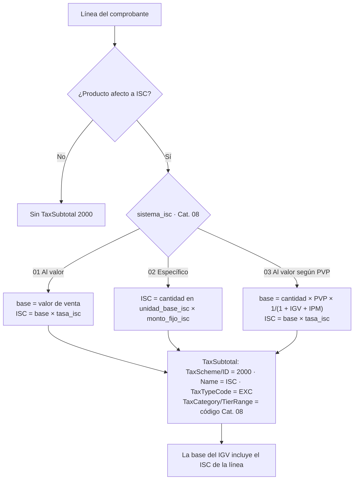

# design.md — 0005 Trazabilidad SUNAT / UBL 2.1

**Feature**: Trazabilidad SUNAT / UBL 2.1  
**ID**: 0005  
**Estado**: EN REVISIÓN  
**Autor**: Equipo Grupo A — UNAS-FIIS  
**Fecha**: 2026-11-11  
**Fuentes**: F-01 (XSD UBL 2.1), F-02 (Catálogos SUNAT), F-03, F-04, Guía XML Factura UBL 2.1 (SUNAT)  
**Alcance:** factura, boleta, nota de crédito y nota de débito electrónicas.

> Este documento complementa a [`spec.md`](spec.md). La spec contiene la matriz **por bloques** (cabecera, emisor, receptor, línea, IGV, ISC, ICBPER, totales, PLE) y la verificación contra el XSD (§17) y la Guía XML (§18). Aquí está la **matriz consolidada en una sola tabla** con la columna **origen en el sistema antiguo** (cruce SUNAT ↔ UBL ↔ dominio ↔ legado) y el **detalle del Catálogo 08**, punto clave del enunciado.

## Criterios y fuentes

Esta matriz cruza el modelo de dominio de `specs/features/0002-modelo-dominio/spec.md`, los DTO de `specs/contracts/facturacion-api.yaml`, UBL 2.1 y las reglas peruanas de emisión electrónica. Se usa `Invoice` como raíz en las rutas de factura/boleta; cuando una ruta cambia para una nota se indica `CreditNote` o `DebitNote`.

Fuentes de contraste:

- [OASIS UBL 2.1, distribución oficial y XSD normativos](https://docs.oasis-open.org/ubl/os-UBL-2.1/).
- [OASIS `UBL-Invoice-2.1.xsd`](https://docs.oasis-open.org/ubl/os-UBL-2.1/xsd/maindoc/UBL-Invoice-2.1.xsd).
- [SUNAT, Guía XML UBL 2.1 para factura electrónica](https://cpe.sunat.gob.pe/sites/default/files/inline-files/guia%2Bxml%2Bfactura%2Bversion%202-1%2B1%2B0%20%282%29_0%20%282%29.pdf).
- [SUNAT, TUO de la Ley del IGV e ISC, título II](https://www.sunat.gob.pe/legislacion/igv/ley/titulo2.htm).

> **Estado de la verificación local (2026-11-11):** los XSD oficiales de UBL 2.1 ya están en `docs/referencias/ubl/` y las rutas XPath de esta matriz se contrastaron con ellos (ver [`spec.md` §17](spec.md)). La columna “Origen en el sistema antiguo” se basa en los supuestos S-01 a S-11 de [`../0006-migracion-legado/diccionario-legado.md`](../0006-migracion-legado/diccionario-legado.md): sigue **Por verificar** hasta obtener una muestra real del sistema antiguo.

## Actualización 2026-11-06

Desde la primera revisión, `specs/contracts/facturacion-api.yaml` y la spec 0005 incorporaron: ISC por línea (`sistema_isc`, `tasa_isc`, `monto_fijo_isc`, `unidad_base_isc`, `precio_venta_publico_sugerido`), `cantidad_bolsas`, `emisor` y `forma_pago`; corrigieron el patrón de serie a `^[FB][A-Z0-9]{3}$`; y fijaron el ICBPER en S/ 0.50 por bolsa desde 2023 (parametrizado por fecha). Las filas de la matriz ya fueron depuradas contra el estado actual del dominio y del DTO (2026-11-06); las rutas XPath se contrastaron con los XSD oficiales de `docs/referencias/ubl/`.

## Matriz

Abreviaturas: **O** = obligatorio; **C** = condicional; **OP** = opcional. La obligatoriedad indicada es la del perfil SUNAT cuando fue posible confirmarla; no debe inferirse solo de la cardinalidad permisiva del XSD UBL.

| Campo del dominio | Campo del DTO | XPath UBL 2.1 | Catálogo / norma SUNAT | Validación | Obligatoriedad | Origen en el sistema antiguo |
|---|---|---|---|---|---|---|
| `ComprobantePago.versionUbl` *(constante del generador `src/facturacion_xml`)* | *(no expuesto; constante de servidor)* | `/Invoice/cbc:UBLVersionID` | UBL 2.1 / guía XML SUNAT | Valor `2.1`. Agregarlo al generador aunque sea constante. | O | **Por verificar:** no existe diccionario legado. |
| `ComprobantePago.customizationId` *(constante del generador)* | *(no expuesto; constante de servidor)* | `/Invoice/cbc:CustomizationID` | Perfil SUNAT UBL 2.1 | Valor del perfil peruano (`2.0` según guía SUNAT consultada). | O | **Por verificar:** no existe diccionario legado. |
| `ComprobantePago.tipoOperacion` | `EmitirComprobanteRequest.tipo_operacion` (default `0101`) | `/Invoice/cbc:ProfileID` | Cat. 51, tipo de operación | Código vigente del catálogo; p. ej. `0101` venta interna. Debe llevar los atributos de lista exigidos por SUNAT. | O en factura/boleta según guía SUNAT | **Por verificar:** podría derivarse del tipo de venta, pero no hay regla legado. |
| `ComprobantePago.tipoComprobante` | `EmitirComprobanteRequest.tipo_comprobante` | `/Invoice/cbc:InvoiceTypeCode` | Cat. 01, tipo de documento | Código de 2 dígitos (`01` factura, `03` boleta); atributos de lista SUNAT. Para notas, el tipo está determinado por la raíz y se referencia el documento afectado. | O | **Por verificar:** identificar columna/código legado. |
| `ComprobantePago.serieCorrelativo` | `serie` + `correlativo` | `/Invoice/cbc:ID` | Reglas SEE / formato de serie | Concatenar `serie-correlativo`; serie de factura inicia `F`, boleta `B`; correlativo 1–8 dígitos. El patrón DTO fue corregido a `^[FB][A-Z0-9]{3}$` (antes admitía `|`). | O | **Por verificar:** identificar serie y número legado y política de ceros. |
| `ComprobantePago.fechaEmision` | `fecha_emision` | `/Invoice/cbc:IssueDate` | Guía XML SUNAT | ISO 8601 `YYYY-MM-DD`; validar plazo de emisión/envío según modalidad vigente. | O | **Por verificar:** identificar fecha de venta/emisión legado. |
| `ComprobantePago.horaEmision` | `hora_emision` | `/Invoice/cbc:IssueTime` | Guía XML SUNAT | `HH:mm:ss` y zona horaria conforme a la guía/perfil. El DTO no obliga el campo. | O según guía SUNAT; **Por verificar** en notas del DTO | **Por verificar:** no se sabe si el legado conserva hora. |
| `ComprobantePago.moneda` | `moneda` | `/Invoice/cbc:DocumentCurrencyCode` | Cat. 02, moneda | Código ISO 4217 admitido por SUNAT; el DTO limita a `PEN`/`USD`. Todos los `currencyID` monetarios deben coincidir. | O | **Por verificar:** identificar moneda legado; no asumir PEN. |
| `Emisor.ruc` | `emisor.ruc` | `/Invoice/cac:AccountingSupplierParty/cac:Party/cac:PartyIdentification/cbc:ID` | Cat. 06 (`schemeID=6`) / RUC | Exactamente 11 dígitos y dígito verificador; emisor activo según validación operativa. | O | **Por verificar:** posiblemente configuración de empresa, no dato de cada venta. |
| `Emisor.razonSocial` | `emisor.razon_social` | `/Invoice/cac:AccountingSupplierParty/cac:Party/cac:PartyLegalEntity/cbc:RegistrationName` | RUC / guía XML SUNAT | No vacío; debe corresponder al RUC. | O | **Por verificar:** maestro/configuración de empresa. |
| `Emisor.nombreComercial` | `emisor.nombre_comercial` | `/Invoice/cac:AccountingSupplierParty/cac:Party/cac:PartyName/cbc:Name` | Guía XML SUNAT | Texto; omitir si no existe. | OP | **Por verificar:** maestro/configuración de empresa. |
| `Emisor.direccionFiscal`, `Emisor.ubigeo` | `emisor.direccion`, `emisor.ubigeo` | `/Invoice/cac:AccountingSupplierParty/cac:Party/cac:PartyLegalEntity/cac:RegistrationAddress/cbc:ID` y `cac:AddressLine/cbc:Line` | Cat. 13 para ubigeo / guía XML SUNAT | Ubigeo de 6 dígitos y dirección del domicilio fiscal o establecimiento, según perfil. Completar país y demás componentes exigidos. | O/C según campo | **Por verificar:** maestro de empresa/local legado. |
| `ClienteReceptor.tipoDocumento` | `receptor.tipo_documento` | `/Invoice/cac:AccountingCustomerParty/cac:Party/cac:PartyIdentification/cbc:ID/@schemeID` | Cat. 06, tipo de documento de identidad | Código vigente. El enum DTO omite valores posibles del catálogo: **Por verificar** alcance funcional. | O/C según tipo de comprobante | **Por verificar:** identificar tipo de documento legado. |
| `ClienteReceptor.numeroDocumento` | `receptor.numero_documento` | `/Invoice/cac:AccountingCustomerParty/cac:Party/cac:PartyIdentification/cbc:ID` | Cat. 06 | Longitud/formato dependiente de `schemeID`; para RUC, 11 dígitos y módulo 11. | O/C | **Por verificar:** maestro de clientes legado. |
| `ClienteReceptor.razonSocialNombres` | `receptor.razon_social` | `/Invoice/cac:AccountingCustomerParty/cac:Party/cac:PartyLegalEntity/cbc:RegistrationName` | Guía XML SUNAT | No vacío cuando el adquirente debe identificarse; correspondencia con documento. | O/C | **Por verificar:** maestro de clientes legado. |
| `ClienteReceptor.direccionFiscal` | `receptor.direccion` | `/Invoice/cac:AccountingCustomerParty/cac:Party/cac:PartyLegalEntity/cac:RegistrationAddress/cac:AddressLine/cbc:Line` | Guía XML SUNAT | Texto y estructura de dirección conforme al perfil. | C/OP; **Por verificar** por tipo de documento | **Por verificar:** maestro de clientes legado. |
| `ItemComprobante.numeroLinea` | `items[].numero_linea` | `/Invoice/cac:InvoiceLine/cbc:ID` | UBL 2.1 / guía SUNAT | Entero positivo, único y secuencial dentro del documento. | O | **Por verificar:** número de detalle o secuencia legado. |
| `ItemComprobante.cantidad` | `items[].cantidad` | `/Invoice/cac:InvoiceLine/cbc:InvoicedQuantity` | UBL 2.1 | Mayor que cero; precisión y redondeo según guía. | O | **Por verificar:** cantidad del detalle legado. |
| `ItemComprobante.unidadMedida` | `items[].unidad_medida` | `/Invoice/cac:InvoiceLine/cbc:InvoicedQuantity/@unitCode` | Cat. 03, unidad de medida | Código UNECE vigente (p. ej. `NIU`, `KGM`); debe ser compatible con el producto y, para ISC específico, con su base física. | O | **Por verificar:** mapear unidad propia del legado a Cat. 03. |
| `ItemComprobante.descripcion` | `items[].descripcion` | `/Invoice/cac:InvoiceLine/cac:Item/cbc:Description` | Guía XML SUNAT | No vacío; longitud/caracteres según reglas SUNAT. | O | **Por verificar:** descripción del producto legado. |
| `ItemComprobante.codigoProducto` | `items[].codigo_producto` | `/Invoice/cac:InvoiceLine/cac:Item/cac:SellersItemIdentification/cbc:ID` | UBL 2.1 / guía SUNAT | Código interno estable; no confundir con código UNSPSC. | OP/C | **Por verificar:** SKU/código de artículo legado. |
| `ItemComprobante.valorUnitario` | `items[].valor_unitario` | `/Invoice/cac:InvoiceLine/cac:Price/cbc:PriceAmount` | Guía XML SUNAT | Importe unitario sin tributos; `currencyID` igual a moneda; no negativo; redondeo normativo. | O | **Por verificar:** derivar del precio/base del detalle legado. |
| `ItemComprobante.precioVentaUnitario` | `items[].precio_unitario` | `/Invoice/cac:InvoiceLine/cac:PricingReference/cac:AlternativeConditionPrice/cbc:PriceAmount` | Cat. 16, tipo de precio | `cbc:PriceTypeCode` hermano con código `01` para precio unitario con impuestos; `02` para valor referencial en operaciones no onerosas, según corresponda. | O/C según operación | **Por verificar:** precio final del detalle legado. |
| `ItemComprobante.valorVentaTotal` | `items[].valor_total` | `/Invoice/cac:InvoiceLine/cbc:LineExtensionAmount` | Guía XML SUNAT | Normalmente cantidad × valor unitario, ajustado por descuentos/cargos de línea; moneda consistente. | O | **Por verificar:** importe/base del detalle legado. |
| `ItemComprobante.tipoAfectacionIgv` | `items[].tipo_afectacion_igv` | `/Invoice/cac:InvoiceLine/cac:TaxTotal/cac:TaxSubtotal/cac:TaxCategory/cbc:TaxExemptionReasonCode` | Cat. 07, afectación al IGV | Código vigente (p. ej. `10`, `20`, `30`); coherente con tasa, base y gratuidad. | O | **Por verificar:** mapear estado tributario del artículo/venta legado. |
| `ItemComprobante.montoIgv` / tributo `1000` | `items[].monto_igv` | `/Invoice/cac:InvoiceLine/cac:TaxTotal/cac:TaxSubtotal[ cac:TaxCategory/cac:TaxScheme/cbc:ID='1000']/cbc:TaxAmount` | Cat. 05 (`1000`, IGV) + Cat. 07 | Cuadrar con base × porcentaje, tolerancias y redondeo SUNAT; `TaxScheme/Name=IGV`, `TaxTypeCode=VAT`. | O/C según afectación | **Por verificar:** impuesto del detalle legado o recalcular. |
| `ItemComprobante.montoIsc` / base calculada | `ItemCalculadoDto.monto_isc` (respuesta); parámetros de entrada `sistema_isc`, `tasa_isc`, `monto_fijo_isc`, `unidad_base_isc`, `precio_venta_publico_sugerido` | `/Invoice/cac:InvoiceLine/cac:TaxTotal/cac:TaxSubtotal[ cac:TaxCategory/cac:TaxScheme/cbc:ID='2000']/cbc:TaxableAmount` | Cat. 05 (`2000`, ISC) + Cat. 08 | Base conforme al sistema ISC; el DTO debe incorporar base, tasa/monto fijo, sistema y monto por línea. | C, si el ítem está afecto | **Por verificar:** no hay campos ISC identificados en legado. |
| `ItemComprobante.montoIsc` | `ItemCalculadoDto.monto_isc`; `totales.total_isc` | `/Invoice/cac:InvoiceLine/cac:TaxTotal/cac:TaxSubtotal[ cac:TaxCategory/cac:TaxScheme/cbc:ID='2000']/cbc:TaxAmount` | Cat. 05 (`2000`, ISC) | Debe resultar de la fórmula del sistema indicado y cuadrar con el total ISC. | C | **Por verificar:** no hay campos ISC identificados en legado. |
| `ItemComprobante.sistemaIsc` / `Producto.sistemaIsc` | `items[].sistema_isc` | `/Invoice/cac:InvoiceLine/cac:TaxTotal/cac:TaxSubtotal[ cac:TaxCategory/cac:TaxScheme/cbc:ID='2000']/cac:TaxCategory/cbc:TierRange` | Cat. 08 | Código `01`, `02` o `03`; coherente con `Percent` o `PerUnitAmount`, base y unidad. Véase sección específica. | C | **Por verificar:** no existe mapeo legado. |
| `ItemComprobante.montoIcbper` | `items[].monto_icbper` | `/Invoice/cac:InvoiceLine/cac:TaxTotal/cac:TaxSubtotal[ cac:TaxCategory/cac:TaxScheme/cbc:ID='7152']/cbc:TaxAmount` | Cat. 05 (`7152`, ICBPER) / Ley 30884 y monto vigente del período | Cantidad de bolsas × importe unitario vigente. Representar base/unidad e importe por unidad en el `TaxSubtotal`; no fijar permanentemente el importe; vigente S/ 0.50 desde 2023. | C | **Por verificar:** cantidad de bolsas e impuesto legado. |
| `ItemComprobante.cantidadBolsas`, importe por bolsa vigente (resuelto por `CatalogoSunatPort`) | `items[].cantidad_bolsas` (entrada); `monto_icbper` (respuesta) | `/Invoice/cac:InvoiceLine/cac:TaxTotal/cac:TaxSubtotal[...='7152']/cbc:BaseUnitMeasure` y `/Invoice/cac:InvoiceLine/cac:TaxTotal/cac:TaxSubtotal[...='7152']/cac:TaxCategory/cbc:PerUnitAmount` | Cat. 05 / Ley 30884 | `BaseUnitMeasure` = número de bolsas; `PerUnitAmount` = importe legal del ejercicio; `TaxAmount` = producto. **Por verificar** contra el XSD local ausente. | C | **Por verificar:** el legado debe distinguir bolsas de cantidad comercial. |
| `ComprobantePago.tributos` (total) | `totales.total_impuestos`, `total_igv`, `total_isc`, `total_icbper` | `/Invoice/cac:TaxTotal/cbc:TaxAmount` y `/Invoice/cac:TaxTotal/cac:TaxSubtotal` | Cat. 05, códigos de tributos | Total general igual a suma de subtotales y a la suma redondeada de líneas; moneda consistente. | O/C | **Por verificar:** cabecera tributaria legado o suma de detalles. |
| `TotalesComprobante.totalValorVenta` | Suma de `total_operaciones_gravadas`, `inafectas`, `exoneradas` | `/Invoice/cac:LegalMonetaryTotal/cbc:LineExtensionAmount` | Guía XML SUNAT | Suma de valores de venta de líneas antes de tributos, con ajustes permitidos. El dominio no detalla los atributos de `TotalesComprobante`: **Por verificar**. | O | **Por verificar:** total base/venta legado. |
| `TotalesComprobante.totalPrecioVenta` | `totales.total_precio_venta` | `/Invoice/cac:LegalMonetaryTotal/cbc:TaxInclusiveAmount` | Guía XML SUNAT | Valor de venta + tributos, antes de descuentos/cargos globales según fórmula SUNAT. Agregar al DTO o derivar de forma inequívoca. | O según guía | **Por verificar:** total con impuestos legado. |
| `TotalesComprobante.descuentosGlobales` | `totales.total_descuentos` | `/Invoice/cac:LegalMonetaryTotal/cbc:AllowanceTotalAmount` | Cat. 53 si se modelan descuentos/cargos | Suma de descuentos globales informados; debe cuadrar con `cac:AllowanceCharge`. | C | **Por verificar:** descuentos de cabecera legado. |
| `TotalesComprobante.cargosGlobales` | `totales.total_cargos` | `/Invoice/cac:LegalMonetaryTotal/cbc:ChargeTotalAmount` | Cat. 53 | Suma de cargos globales; debe cuadrar con `cac:AllowanceCharge`. | C | **Por verificar:** cargos de cabecera legado. |
| `TotalesComprobante.importeTotal` | `totales.importe_total` | `/Invoice/cac:LegalMonetaryTotal/cbc:PayableAmount` | Guía XML SUNAT | Importe pagadero según fórmula del perfil; mayor o igual a cero y moneda consistente. | O | **Por verificar:** total final legado. |
| `ComprobantePago.hashSha256` y firma embebida en el XML (`FirmaDigitalPort`) | La firma viaja en el XML descargable; el JSON solo expone `hash_sha256` | `/Invoice/ext:UBLExtensions/ext:UBLExtension/ext:ExtensionContent/ds:Signature` | RS 097-2012/SUNAT, XMLDSig | Firma enveloped XMLDSig con certificado vigente y RUC correspondiente; validar referencias, digest y firma. `hash_sha256` no sustituye la firma. | O antes del envío | **Por verificar:** normalmente generado por el sistema nuevo, no migrado. |
| `NotaCredito.comprobanteReferenciado` | `NotaCreditoRequest.documento_referenciado` | `/CreditNote/cac:BillingReference/cac:InvoiceDocumentReference/cbc:ID` | Cat. 12, tipo de documento relacionado | ID `serie-correlativo`; agregar `cbc:DocumentTypeCode` con código Cat. 12 coherente con el documento afectado. | O | **Por verificar:** vínculo al comprobante original legado. |
| `NotaCredito.tipoNota` | `NotaCreditoRequest.motivo.codigo` | `/CreditNote/cac:DiscrepancyResponse/cbc:ResponseCode` | Cat. 09, tipo de nota de crédito | Código vigente; coherente con el alcance de líneas/totales y documento afectado. | O | **Por verificar:** motivo/código de anulación o ajuste legado. |
| `NotaCredito.motivoSustento` | `NotaCreditoRequest.motivo.descripcion` | `/CreditNote/cac:DiscrepancyResponse/cbc:Description` | Cat. 09 / guía de notas | Texto no vacío y coherente con `ResponseCode`; `ReferenceID` debe identificar el comprobante afectado. | O | **Por verificar:** glosa/motivo legado. |
| `NotaDebito.comprobanteReferenciado` | `NotaDebitoRequest.documento_referenciado` | `/DebitNote/cac:BillingReference/cac:InvoiceDocumentReference/cbc:ID` | Cat. 12, tipo de documento relacionado | ID `serie-correlativo`; informar `cbc:DocumentTypeCode` según Cat. 12. | O | **Por verificar:** vínculo al comprobante original legado. |
| `NotaDebito.tipoNota` | `NotaDebitoRequest.motivo.codigo` | `/DebitNote/cac:DiscrepancyResponse/cbc:ResponseCode` | Cat. 10, tipo de nota de débito | Código vigente y coherente con el recargo/ajuste realizado. | O | **Por verificar:** motivo/código de ajuste legado. |
| `NotaDebito.motivoSustento` | `NotaDebitoRequest.motivo.descripcion` | `/DebitNote/cac:DiscrepancyResponse/cbc:Description` | Cat. 10 / guía de notas | Texto no vacío; `ReferenceID` debe identificar el comprobante afectado. | O | **Por verificar:** glosa/motivo legado. |

## Catálogo 08: sistema de cálculo del ISC

El Catálogo 08 selecciona **cómo** se determina el ISC de una línea. El código se informa en `cac:TaxCategory/cbc:TierRange` dentro del `TaxSubtotal` cuyo `cac:TaxScheme/cbc:ID` es `2000`. La ley distingue tres sistemas (arts. 55, 56, 59 y 60 del TUO de la Ley del IGV e ISC):

| Código Cat. 08 | Sistema | Fórmula | Reflejo esperado en UBL 2.1 |
|---|---|---|---|
| `01` | Sistema al valor | `ISC = base imponible × tasa ISC`. En venta interna, la base es el valor de venta; en importación, valor en aduana más derechos de importación. | `TaxableAmount` = base; `TaxCategory/Percent` = tasa porcentual; `TaxCategory/TierRange` = `01`; `TaxAmount` = ISC calculado; `TaxScheme/ID` = `2000`. |
| `02` | Sistema específico | `ISC = volumen vendido o importado × monto fijo por unidad`. El monto fijo y la unidad dependen del bien y de la norma vigente. | `TaxSubtotal/BaseUnitMeasure` = volumen/cantidad y unidad normativa; `TaxCategory/PerUnitAmount` = monto fijo; `TaxCategory/TierRange` = `02`; `TaxAmount` = producto; `TaxScheme/ID` = `2000`. Rutas verificadas contra el XSD local (`TaxSubtotalType` y `TaxCategoryType` admiten ambos elementos; ver [`spec.md` §17](spec.md)). |
| `03` | Sistema al valor según precio de venta al público | `factor = 1 / (1 + tasa IGV + tasa IPM)`; `base = cantidad × PVP sugerido × factor`; `ISC = base × tasa ISC`. El factor se considera con la precisión establecida por la norma vigente. | `TaxableAmount` = base derivada del PVP; `TaxCategory/Percent` = tasa ISC; `TaxCategory/TierRange` = `03`; `TaxAmount` = ISC; `TaxScheme/ID` = `2000`. **Por verificar:** el elemento exacto para consignar PVP sugerido en el perfil SUNAT y XSD local. |

Reglas transversales:

1. No se debe deducir el sistema únicamente por la tasa: se guarda el código Cat. 08 que corresponda al bien y período.
2. Tasas, montos fijos, bienes afectos y unidades son datos normativos versionados; deben resolverse por fecha de emisión, no codificarse como constantes permanentes.
3. El ISC de cabecera es la suma de los ISC de línea después de aplicar las reglas de redondeo SUNAT.
4. **Resuelto (2026-11-06):** el contrato ya representa los tres sistemas por línea con `sistema_isc` (Cat. 08), `tasa_isc` (sistemas `01` y `03`), `monto_fijo_isc` y `unidad_base_isc` (sistema `02`) y `precio_venta_publico_sugerido` (sistema `03`), con validación condicional por sistema. La base y el monto del ISC no los envía el cliente: los calcula el dominio y se devuelven en la respuesta.
5. Ejemplos numéricos de los tres sistemas: [`../0002-modelo-dominio/spec.md` §5.2–5.4](../0002-modelo-dominio/spec.md). Las tasas de esos ejemplos son **ilustrativas**, no normativas.

### Flujo de decisión del ISC por línea

> ⚠️ Por verificar: que la base del IGV incluya el ISC sigue lo dispuesto en el TUO de la Ley del IGV e ISC; confirmar con la Guía XML vigente.

## Catálogos utilizados

| Catálogo | Propósito en esta especificación | Uso principal |
|---|---|---|
| 01 | Tipo de documento | `InvoiceTypeCode` (`01`, `03`, etc.). |
| 02 | Moneda | `DocumentCurrencyCode` y atributos `currencyID`. |
| 03 | Unidad de medida | `InvoicedQuantity/@unitCode` y cantidades físicas. |
| 05 | Códigos de tributos | Identifica IGV `1000`, ISC `2000` e ICBPER `7152` en `TaxScheme`. |
| 06 | Tipo de documento de identidad | `PartyIdentification/ID/@schemeID` de emisor y adquirente. |
| 07 | Tipo de afectación al IGV | `TaxExemptionReasonCode` por línea. |
| 08 | Sistema de cálculo del ISC | `TaxCategory/TierRange`: al valor, específico o por PVP. |
| 09 | Tipo/motivo de nota de crédito | `CreditNote/DiscrepancyResponse/ResponseCode`. |
| 10 | Tipo/motivo de nota de débito | `DebitNote/DiscrepancyResponse/ResponseCode`. |
| 12 | Tipo de documento relacionado | `BillingReference/InvoiceDocumentReference/DocumentTypeCode`. |
| 13 | Ubigeo | Identificación geográfica de domicilios/establecimientos. **Por verificar:** obligatoriedad por tipo de documento y versión de guía. |
| 16 | Tipo de precio de venta unitario | `AlternativeConditionPrice/PriceTypeCode`. |
| 51 | Tipo de operación | `ProfileID` (`0101` venta interna y demás códigos aplicables). |
| 53 | Motivo de descuento o cargo | `AllowanceChargeReasonCode`, si se implementan descuentos/cargos de línea o globales. |

## Brechas pendientes

| Brecha | Estado |
|---|---|
| XSD oficiales de UBL 2.1 en el repositorio | **Resuelta 2026-11-06**: `docs/referencias/ubl/`. Rutas verificadas en `specs/features/0005-trazabilidad-sunat-ubl/spec.md`, sección 17. |
| Dominio y DTO sin versión/perfil UBL, tipo de operación, ISC, totales UBL | **Resuelta 2026-11-06**: `tipo_operacion`, ISC por línea, `total_valor_venta`, `total_precio_venta`, `total_descuentos`, `total_cargos`. Versión UBL y `CustomizationID` son constantes del generador. |
| Catálogos SUNAT versionados (Anexo 8) y guía XML de factura | **Abierta**: no se pudieron descargar de forma verificable; deben incorporarse a `docs/referencias/sunat/`. |
| Esquemas XSD propios de SUNAT para baja y resumen (`VoidedDocuments`, `SummaryDocuments`) | **Abierta**: no están en OASIS; incorporarlos desde la fuente SUNAT. |
| Posición exacta de `PerUnitAmount`/`BaseUnitMeasure` (en `TaxSubtotal` o en `TaxCategory`) | **Abierta**: ambas válidas en el XSD; fijarlas con la guía SUNAT. |
| Diccionario del sistema legado | **Abierta**: sin él, la columna "Origen en el sistema antiguo" sigue "Por verificar". |
| Uso de "tabla 04" vs "Catálogo 02" para moneda | **Resuelta**: se adopta Catálogo 02; archivar la versión concreta cuando se incorpore el Anexo 8. |
