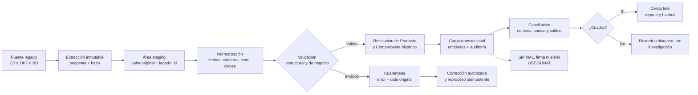

# design.md — 0006 Migración de datos legados

> Restricción **Legado y migración de datos** del enunciado. Complementa a [`spec.md`](spec.md); supuestos del sistema antiguo en [`diccionario-legado.md`](diccionario-legado.md).

**Estado:** EN REVISIÓN  
**Fecha:** 2026-10-22  
**Alcance:** importación histórica de movimientos de almacén, productos y referencias de comprobantes.

## Supuestos y límites

La fuente mínima conocida contiene `fecha`, `ingreso`, `salida`, `producto` y `nro_documento`. No existe todavía un diccionario físico del sistema antiguo; por tanto, nombres de tablas, formatos concretos, zona horaria, unidad de medida y significado exacto de `nro_documento` deben verificarse durante el perfilado. Mientras tanto, [`diccionario-legado.md`](diccionario-legado.md) documenta los supuestos de trabajo (S-01 a S-11), que se confirman o se reemplazan en ese perfilado.

La migración preserva la historia operativa, pero **no convierte registros antiguos en nuevas emisiones fiscales**. Los comprobantes y movimientos históricos:

- no invocan `EmitirComprobanteUseCase`;
- no generan ni firman un nuevo XML UBL;
- no se envían ni reenvían al OSE o a SUNAT;
- se cargan con `origen = LEGADO`, `es_historico = true` y `envio_sunat_habilitado = false`;
- conservan, si existe, el estado, XML, CDR o número de documento original como evidencia inmutable.

Una corrección tributaria requerida después de la migración debe tramitarse mediante el caso de uso fiscal correspondiente y nunca alterando o reenviando silenciosamente el registro histórico.

## Mapeo de campos

| Campo antiguo | Tipo esperado en origen | Entidad y campo destino | Tipo destino | Transformación | Regla de limpieza y validación |
|---|---|---|---|---|---|
| `fecha` | Texto, fecha o fecha-hora | `MovimientoAlmacen.fechaMovimiento`, `precisionTemporal` | `Instant`, enum | Parsear con una lista cerrada de formatos detectados; interpretar con la zona `America/Lima`; conservar el valor original en auditoría. Si solo hay fecha, usar inicio del día como representación técnica y marcar `precisionTemporal=FECHA`, sin fingir que la hora era conocida. | Recortar espacios; rechazar fechas imposibles, futuras respecto del corte o anteriores al inicio acordado. Fechas ambiguas `dd/MM` vs. `MM/dd` van a cuarentena. |
| `fecha` | Texto, fecha o fecha-hora | `Comprobante.fechaEmision` | `LocalDate` | Extraer la fecha civil peruana del valor normalizado. Solo crear la referencia histórica de comprobante cuando `nro_documento` sea válido. | Misma regla anterior; no usar fecha de importación como sustituto. La ausencia de fecha en un documento exige cuarentena. |
| `ingreso` | Texto numérico, entero o decimal | `MovimientoAlmacen.cantidad` + `tipo=INGRESO` | `Decimal` positivo | Normalizar separador decimal/miles y convertir a magnitud positiva. Crear un movimiento de ingreso cuando el valor sea mayor que cero. | Nulo/vacío se interpreta como cero solo si `salida` es positiva. Rechazar negativos, NaN, texto no numérico y exceso de escala. Si `ingreso` y `salida` son ambos positivos, cuarentena. |
| `salida` | Texto numérico, entero o decimal | `MovimientoAlmacen.cantidad` + `tipo=SALIDA` | `Decimal` positivo | Normalizar y convertir a magnitud positiva. Crear un movimiento de salida cuando el valor sea mayor que cero. | Nulo/vacío se interpreta como cero solo si `ingreso` es positivo. Rechazar negativos y valores no numéricos. Ambos en cero o ambos positivos van a cuarentena. No guardar salidas como cantidades negativas. |
| `producto` | Texto o código alfanumérico | `Producto.codigoLegado` | `String` | Conservar el código normalizado como clave natural de enlace; resolverlo a `Producto.id`. Si la fuente mezcla código y descripción, separar solo mediante una regla aprobada y versionada. | `trim`, normalización Unicode NFC, colapso de espacios y comparación insensible a mayúsculas para detectar duplicados; conservar grafía original. Vacío, duplicado ambiguo o sin correspondencia va a cuarentena. No eliminar ceros iniciales. |
| `producto` | Texto descriptivo, cuando aplique | `Producto.descripcion` | `String` | Usar la descripción del maestro legado; si el campo solo contiene código, completar desde el maestro y no inventar descripción. | Eliminar caracteres de control, espacios laterales y duplicados; no cambiar signos ni abreviaturas con significado comercial. Descripción faltante queda marcada para revisión. |
| `nro_documento` | Texto alfanumérico | `Comprobante.numeroDocumentoOriginal` | `String` | Convertir a mayúsculas, normalizar guiones y conservar el texto original. Cuando cumpla `SERIE-CORRELATIVO`, separar en `serieOriginal` y `correlativoOriginal` sin generar una serie nueva. | `trim`; retirar caracteres de control; no eliminar ceros significativos. Duplicados se resuelven por clave de origen y contenido: idénticos son reintentos idempotentes; distintos van a cuarentena. |
| `nro_documento` | Texto alfanumérico | `MovimientoAlmacen.comprobanteId` | `UUID?` | Buscar el `Comprobante` histórico creado en el mismo lote y asociarlo. Si no existe documento pero el movimiento es válido, permitir nulo con motivo `SIN_DOCUMENTO_ORIGEN`, según política contable aprobada. | Una referencia múltiple o ambigua va a cuarentena. La asociación nunca dispara emisión ni envío fiscal. |
| Clave física o compuesta de la fila **(requerida aunque no figure en la lista mínima)** | Entero/texto | `MovimientoAlmacen.legadoId`, `Comprobante.legadoId` y auditoría | `String` | Construir `sistema:tabla:clave`; si no hay PK, usar hash SHA-256 del archivo, número de línea y contenido canónico. | Debe ser único, estable y reproducible. Una colisión no se sobreescribe: se detiene el lote y se investiga. |

### Invariantes de destino

- Un registro produce como máximo un movimiento: `INGRESO XOR SALIDA`.
- `cantidad > 0` y utiliza decimal exacto, nunca punto flotante binario.
- Todo movimiento referencia un `Producto` existente.
- El saldo por producto se calcula como `Σ ingresos − Σ salidas`; no se modifica para forzar un cuadre.
- Un `Comprobante` migrado es una representación histórica y queda separado de los comprobantes electrónicos emitidos por el sistema nuevo.
- La carga es idempotente: repetir el mismo lote no duplica productos, movimientos ni comprobantes.

## Flujo ETL

### 1. Extracción

1. Detener escrituras o fijar un corte consistente de la fuente.
2. Copiar los archivos/tablas en modo solo lectura y registrar sistema, tabla/archivo, tamaño, conteo, fecha de corte y SHA-256.
3. Asignar `lote_id` y `legado_id` estable a cada fila. Nunca transformar el archivo original.
4. Guardar cada valor original como texto en *staging* para permitir reproducción y evidencia.

### 2. Normalización

- Detectar codificación antes de convertir a UTF-8; registrar caracteres sustituidos como error, no ocultarlos.
- Aplicar reglas versionadas (`reglas_version`) para fechas, decimales, texto y claves.
- Separar `serie-correlativo` solo cuando el patrón sea inequívoco.
- Resolver productos por `codigoLegado`; las coincidencias aproximadas solo generan sugerencias y requieren aprobación humana.

### 3. Validación

Se ejecutan validaciones de esquema, tipo y negocio: campos obligatorios, fecha válida, exclusión ingreso/salida, cantidad positiva, producto resoluble, documento no ambiguo y ausencia de duplicados conflictivos. Cada fallo produce un código estable (`FECHA_AMBIGUA`, `MOVIMIENTO_DOBLE`, `PRODUCTO_NO_ENCONTRADO`, etc.).

### 4. Carga

- Cargar primero productos, luego comprobantes históricos y finalmente movimientos.
- Usar transacciones por lote o bloques reiniciables con *checkpoint*.
- Insertar entidad y fila de auditoría en la misma transacción.
- Aplicar `UPSERT` solo por la clave de idempotencia `(sistema_origen, tipo_entidad, legado_id)`; nunca por descripción o monto.
- Forzar en base de datos `es_historico=true` y `envio_sunat_habilitado=false` para todo comprobante legado.

### 5. Conciliación

Comparar por lote y producto:

- filas extraídas = cargadas + cuarentena + descartadas autorizadas;
- suma de ingresos y salidas de origen normalizado contra destino;
- saldos inicial/final cuando el legado los proporcione;
- cantidad de documentos únicos y duplicados;
- totales por fecha y por producto.

El lote solo se cierra si todas las diferencias son cero o cuentan con una excepción aprobada, identificada y firmada por el responsable. Se genera un reporte inmutable con hashes de entrada y salida.

## Auditoría `legado_id → nuevo_id`

Tabla propuesta `migracion_trazabilidad`:

| Columna | Tipo | Restricción / propósito |
|---|---|---|
| `id` | UUID | PK técnica. |
| `lote_id` | UUID | FK al lote ETL. |
| `sistema_origen` | VARCHAR(50) | Nombre/versionado de la fuente. |
| `tabla_origen` | VARCHAR(100) | Tabla o archivo original. |
| `legado_id` | VARCHAR(255) | Clave original o clave sintética reproducible. |
| `tipo_entidad` | VARCHAR(40) | `PRODUCTO`, `MOVIMIENTO_ALMACEN` o `COMPROBANTE`. |
| `nuevo_id` | UUID | ID de la entidad destino. |
| `hash_origen` | CHAR(64) | SHA-256 del registro canónico de entrada. |
| `reglas_version` | VARCHAR(30) | Versión del mapeo/limpieza aplicado. |
| `estado` | VARCHAR(20) | `CARGADO`, `CUARENTENA`, `DESCARTADO_AUTORIZADO`. |
| `migrado_en` | TIMESTAMP WITH TIME ZONE | Momento de procesamiento. |
| `detalle` | JSON | Transformaciones, advertencias y referencias asociadas. |

Restricciones: `UNIQUE(sistema_origen, tabla_origen, legado_id, tipo_entidad)` y `UNIQUE(tipo_entidad, nuevo_id)`. La tabla es de solo anexado para usuarios operativos; correcciones generan una nueva ejecución vinculada, no borran evidencia.

## Cuarentena y reproceso

Los registros inválidos se almacenan en `migracion_cuarentena` con `lote_id`, `legado_id`, fila original, fila normalizada, códigos de error, fecha, intentos y estado (`PENDIENTE`, `CORREGIDO`, `DESCARTADO_AUTORIZADO`). No se insertan parcialmente en tablas productivas.

El reproceso exige:

1. corrección registrada como un parche separado, sin alterar la extracción original;
2. usuario, fecha, motivo y evidencia de aprobación;
3. nueva validación con la misma o una versión posterior de reglas;
4. carga idempotente y actualización del estado de cuarentena;
5. repetición de la conciliación del lote.

No se permite “corregir” una fecha, cantidad, producto o documento mediante un valor supuesto. Si no puede determinarse con evidencia, permanece en cuarentena o se descarta mediante autorización documentada.

## Catálogo de códigos de error de cuarentena

| Código | Condición | Acción |
|---|---|---|
| `FECHA_INVALIDA` | Fecha imposible, futura respecto del corte o anterior al inicio acordado. | Cuarentena. |
| `FECHA_AMBIGUA` | Formato `dd/MM` vs. `MM/dd` indeterminable. | Cuarentena; requiere evidencia del formato. |
| `FECHA_AUSENTE` | Documento sin fecha. | Cuarentena. |
| `CANTIDAD_NO_NUMERICA` | `ingreso` o `salida` no numérico, NaN o con exceso de escala. | Cuarentena. |
| `CANTIDAD_NEGATIVA` | `ingreso` o `salida` negativo. | Cuarentena. |
| `MOVIMIENTO_DOBLE` | `ingreso` y `salida` ambos positivos en la misma fila. | Cuarentena. |
| `MOVIMIENTO_VACIO` | `ingreso` y `salida` ambos en cero o ausentes. | Cuarentena. |
| `PRODUCTO_VACIO` | Código de producto vacío. | Cuarentena. |
| `PRODUCTO_NO_ENCONTRADO` | Sin correspondencia en el maestro. | Cuarentena; sugerencias aproximadas solo con aprobación humana. |
| `PRODUCTO_AMBIGUO` | Más de un producto coincide. | Cuarentena. |
| `DOCUMENTO_AMBIGUO` | `nro_documento` con referencia múltiple o formato no inequívoco. | Cuarentena. |
| `DOCUMENTO_DUPLICADO_CONFLICTIVO` | Misma clave de origen con contenido distinto. | Cuarentena. |
| `SIN_DOCUMENTO_ORIGEN` | Movimiento válido sin documento. | Se carga con `comprobanteId` nulo si la política contable lo permite; si no, cuarentena. |
| `CODIFICACION_INVALIDA` | Caracteres sustituidos al convertir a UTF-8. | Cuarentena. |
| `COLISION_LEGADO_ID` | Dos filas distintas producen el mismo `legado_id`. | **Detiene el lote.** |

## Casos de prueba especificados

| ID | Entrada | Resultado esperado |
|---|---|---|
| T-MIG-01 | Fila válida: fecha `2026-10-01`, ingreso `10`, salida vacía, producto `A1`, doc `F001-42` | 1 movimiento `INGRESO` de 10; comprobante histórico `F001-42`. |
| T-MIG-02 | Fecha `05/06/2026` sin evidencia de formato | `FECHA_AMBIGUA`; nada cargado. |
| T-MIG-03 | Fila con ingreso `5` y salida `3` | `MOVIMIENTO_DOBLE`. |
| T-MIG-04 | Ingreso `-4` | `CANTIDAD_NEGATIVA`. |
| T-MIG-05 | Ingreso `1,5` con separador decimal coma | Normalizado a `1.5` y cargado. |
| T-MIG-06 | Producto `a1 ` y otro `A1` | Se tratan como el mismo código tras normalizar; si el maestro tiene ambos, `PRODUCTO_AMBIGUO`. |
| T-MIG-07 | Mismo lote cargado dos veces | La segunda carga no crea registros nuevos (idempotencia). |
| T-MIG-08 | Dos filas con el mismo `nro_documento` y contenido idéntico | Reintento idempotente, un solo comprobante histórico. |
| T-MIG-09 | Mismo `nro_documento` con contenido distinto | `DOCUMENTO_DUPLICADO_CONFLICTIVO`. |
| T-MIG-10 | Comprobante migrado | `es_historico = true`, `envio_sunat_habilitado = false`; intentar enviarlo a `EnvioOsePort` falla. |
| T-MIG-11 | Conciliación con diferencia ≠ 0 sin excepción aprobada | Lote bloqueado; no se cierra. |
| T-MIG-12 | Valor original con ceros iniciales (`000123`) | Se conserva sin recortar ceros. |
| T-MIG-13 | Fecha `2026-02-30` | `FECHA_INVALIDA`. |
| T-MIG-14 | Fecha posterior a la fecha de corte del lote | `FECHA_INVALIDA`. |
| T-MIG-15 | Fila de documento sin fecha | `FECHA_AUSENTE`. |
| T-MIG-16 | Ingreso `abc` | `CANTIDAD_NO_NUMERICA`. |
| T-MIG-17 | Ingreso y salida vacíos (o ambos `0`) | `MOVIMIENTO_VACIO`. |
| T-MIG-18 | Producto vacío | `PRODUCTO_VACIO`. |
| T-MIG-19 | Producto `ZZ99` que no existe en el maestro | `PRODUCTO_NO_ENCONTRADO`; no se crea el producto por inferencia. |
| T-MIG-20 | `nro_documento` `F001-42 / F001-43` (dos documentos en un campo) | `DOCUMENTO_AMBIGUO`. |
| T-MIG-21 | Archivo en Latin-1 convertido sin declarar la codificación (aparece `\uFFFD`) | `CODIFICACION_INVALIDA`. |
| T-MIG-22 | Dos filas distintas que generan el mismo `legado_id` | `COLISION_LEGADO_ID`; **se detiene el lote**. |
| T-MIG-23 | Movimiento válido sin `nro_documento` con política "permitir" | Se carga con `comprobanteId` nulo y motivo `SIN_DOCUMENTO_ORIGEN`. |
| T-MIG-24 | Igual que T-MIG-23 con política "no permitir" | `SIN_DOCUMENTO_ORIGEN` en cuarentena. |

**Cobertura**: cada uno de los 15 códigos del catálogo tiene al menos una prueba (`FECHA_INVALIDA` 13–14, `FECHA_AMBIGUA` 02, `FECHA_AUSENTE` 15, `CANTIDAD_NO_NUMERICA` 16, `CANTIDAD_NEGATIVA` 04, `MOVIMIENTO_DOBLE` 03, `MOVIMIENTO_VACIO` 17, `PRODUCTO_VACIO` 18, `PRODUCTO_NO_ENCONTRADO` 19, `PRODUCTO_AMBIGUO` 06, `DOCUMENTO_AMBIGUO` 20, `DOCUMENTO_DUPLICADO_CONFLICTIVO` 09, `SIN_DOCUMENTO_ORIGEN` 23–24, `CODIFICACION_INVALIDA` 21, `COLISION_LEGADO_ID` 22).

## Reproceso de cuarentena en la API

El reproceso tiene contrato propio en [`specs/contracts/facturacion-api.yaml`](../../contracts/facturacion-api.yaml) (caso de uso CU-14). Ya no depende de `POST /migraciones/legado` ni queda limitado al CLI.

| Método | Ruta | Uso |
|---|---|---|
| `GET` | `/migraciones/{id}/cuarentena` | Lista los registros en cuarentena del lote con su código de error, fila original y estado. Admite filtros `estado` y `codigo_error` y paginación. |
| `POST` | `/migraciones/{id}/reprocesos` | Aplica parches aprobados y crea un lote nuevo con `lote_origen_id = {id}`. Responde `202`. Exige la cabecera `Idempotency-Key`. |

Cada parche (`ParcheCuarentena`) lleva `legado_id`, `accion` (`CORREGIR` o `DESCARTAR`), `motivo`, `evidencia` y `aprobado_por`; para `CORREGIR` también `campo` y `valor_corregido`. Se cumplen así los cinco pasos del reproceso descritos arriba:

1. El parche se guarda por separado; la extracción original no se toca.
2. Usuario, motivo y evidencia son obligatorios; sin evidencia el servidor responde `422` y el registro sigue en cuarentena.
3. Cada registro se valida de nuevo con la `version_reglas` indicada (la del lote original o una posterior).
4. La carga es idempotente por `(sistema_origen, tipo_entidad, legado_id)`; repetir la misma `Idempotency-Key` devuelve el lote ya creado.
5. Se repite la conciliación del lote y se registra la auditoría `legado_id → nuevo_id`.

Reglas adicionales:

- El lote de origen no debe estar `EN_PROCESO` ni tener otro reproceso activo (`409`).
- `COLISION_LEGADO_ID` no es reprocesable: detiene el lote y se investiga (`422`).
- El reproceso nunca emite, firma ni envía comprobantes a OSE/SUNAT; los comprobantes migrados siguen siendo históricos.
- El CLI de migración invoca el mismo caso de uso (`MigrarLegadoUseCase`) y deja la misma auditoría.
