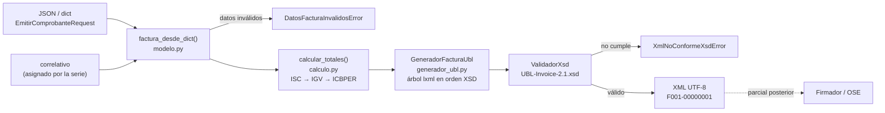

# design.md — 0008 Generación del XML UBL 2.1 (Invoice)

**Feature**: Generación del XML UBL 2.1  
**ID**: 0008  
**Estado**: APROBADO  
**Autor**: Equipo Grupo A — UNAS-FIIS  
**Fecha**: 2026-11-11

> Complementa a [`spec.md`](spec.md). La documentación técnica completa, con la estructura del XML, la validación XSD y los resultados, está en [`docs/documentacion-tecnica-xml.md`](../../../docs/documentacion-tecnica-xml.md).

---

## Contexto de diseño

El generador implementa el puerto de salida `GeneradorXmlUblPort` de la arquitectura ([0003](../0003-arquitectura-mvc-hexagonal/design.md)). La implementación principal es `GeneradorUblJaxbAdapter` en Java 21 con clases JAXB generadas desde el XSD ([ADR-0006](../../adr/0006-generador-ubl-java-jaxb.md), código en [`generador-java/`](../../../generador-java/)); no depende de base de datos ni de servidor web: recibe datos y devuelve bytes. El prototipo en Python ([ADR-0005](../../adr/0005-generador-ubl-python-lxml.md)) se conserva como referencia y como oráculo de la regresión cruzada.

## Decisiones de diseño

### Árbol de elementos en lugar de plantillas

**Problema**: el docente penalizó las plantillas Freemarker, porque una etiqueta mal escrita pasa desapercibida.  
**Opción elegida**: lxml, construyendo cada elemento con su espacio de nombres y en el orden del XSD.  
**Justificación**: el XML se valida siempre contra el XSD oficial antes de entregarse.  
**ADR relacionado**: [`0005-generador-ubl-python-lxml.md`](../../adr/0005-generador-ubl-python-lxml.md)

### XSD local sin modificar

**Problema**: en la distribución oficial, `UBL-Invoice-2.1.xsd` importa `../common/*.xsd`, pero en el repositorio todos los XSD están en una sola carpeta de solo lectura.  
**Opción elegida**: un *resolver* de lxml que traduce cada `schemaLocation` al archivo local del mismo nombre, sin acceso a red (`no_network=True`).  
**Justificación**: no se toca ningún archivo oficial y la validación es reproducible sin conexión.

## Diagrama

## Componentes involucrados

| Componente | Archivo | Responsabilidad |
|---|---|---|
| Catálogos | `src/facturacion_xml/catalogos.py` | Códigos SUNAT (01, 02, 03, 05, 06, 07, 08, 16, 51, 52), categorías 1001–1004, tasas de IGV, ICBPER por año. |
| Modelo | `src/facturacion_xml/modelo.py` | DTO → `Factura`; validación de la entrada con la ruta de cada error. |
| Cálculo | `src/facturacion_xml/calculo.py` | Importes con `Decimal` y redondeo a 2 decimales. |
| Generador | `src/facturacion_xml/generador_ubl.py` | Construcción del árbol `Invoice` UBL 2.1. |
| Validador | `src/facturacion_xml/validador_xsd.py` | Compilación del XSD oficial y validación. |
| Letras | `src/facturacion_xml/numero_letras.py` | Leyenda 1000 (importe en letras). |
| CLI | `src/facturacion_xml/__main__.py` | `python -m facturacion_xml entrada.json salida.xml --correlativo N`. |

## Notas

> ⚠️ Por verificar: ver la sección "Por verificar" de [`spec.md`](spec.md).
